<Table>
  <tr>
    <td><a href= "https://www.btgpactual.com/"></td>
    <td>
      <a href= "https://www.inteli.edu.br/"></a>
    </td>
  </tr>
</table>

# Nome do Projeto: <nome do projeto>

## Nome do Grupo: <nome do grupo>

## Integrantes:

- <a href="https://www.linkedin.com/in/anacdejesus/">Ana Carolina Pacheco</a>
- <a href="https://www.linkedin.com/in/felipe-zillo-72b367247/">Felipe Zillo</a>
- <a href="https://www.linkedin.com/in/gabriel-nascimento-563382243/">Gabriel Nascimento</a>
- <a href="https://www.linkedin.com/in/joao-souza-campos/">João Victor de Souza Campos</a>
- <a href="https://www.linkedin.com/in/lucas-tort/">Lucas Cozzolino Tort</a>
- <a href="https://www.linkedin.com/in/natalycunha/">Nataly Cunha</a>
- <a href="https://www.linkedin.com/in/thiagovolcati/">Thiago Volcati</a>
- <a href="https://www.linkedin.com/in/vitor-balbo/">Vitor Balbo</a>

# Sumário

- [1. Introdução](#1-introdução)
  - [1.1 Termos e Abreviações](#11-termos-e-abreviações)
  - [1.2 Objetivo do Documento](#12-objetivo-do-documento)
- [2. Entendimento do Projeto e do Negócio](#2-entendimento-do-projeto-e-do-negócio)
  - [2.1 Contexto da Indústria do Parceiro](#21-contexto-da-indústria-do-parceiro)
  - [2.2 Problema](#22-problema)
  - [2.3 Visão do Projeto e do Produto](#23-visão-do-projeto-e-do-produto)
  - [2.4 Personas e Jornada do Usuário](#24-personas-e-jornada-do-usuário)
  - [2.5 Modelagem do Fluxo de Negócio](#25-modelagem-do-fluxo-de-negócio)
    - [2.5.1 Cadeia de Valor](#251-cadeia-de-valor)
    - [2.5.2 Fluxo de Negócio Proposto (AS-IS e TO-BE)](#252-fluxo-de-negócio-proposto-as-is-e-to-be)
  - [2.6 Matriz de Risco do Projeto](#26-matriz-de-risco-do-projeto)
  - [2.7 Ideação](#27-ideação)
  - [2.8 Canvas do Projeto](#28-canvas-do-projeto)
  - [2.9 Estimativa de Investimento](#29-estimativa-de-investimento)
- [3. Requisitos do Projeto](#3-requisitos-do-projeto)
  - [3.1 Requisitos Funcionais (RFs)](#31-requisitos-funcionais-rfs)
  - [3.2 Requisitos Não Funcionais (RNFs)](#32-requisitos-não-funcionais-rnfs)
  - [3.3 Correlação RFs e RNFs](#33-correlação-rfs-e-rnfs)
- [4. Modelagem de Dados](#4-modelagem-de-dados)
  - [4.1 Especificação da Base de Dados para Modelo de Recomendação](#41-especificação-da-base-de-dados-para-modelo-de-recomendação)
  - [4.2 Modelo Conceitual de Dados](#42-modelo-conceitual-de-dados)
  - [4.3 Modelo Lógico de Dados](#43-modelo-lógico-de-dados)
  - [4.4 Modelo Físico de Dados](#44-modelo-físico-de-dados)
- [5. Solução Técnica (Design)](#5-solução-técnica-design)
  - [5.1 Diagrama de Casos de Uso](#51-diagrama-de-casos-de-uso)
  - [5.2 Diagrama de Classes](#52-diagrama-de-classes)
  - [5.3 Diagrama de Componentes da UML](#53-diagrama-de-componentes-da-uml)
  - [5.4 Diagramas de Sequência da UML](#54-diagramas-de-sequência-da-uml)
  - [5.5 Tecnologias e Linguagens](#55-tecnologias-e-linguagens)
- [6. Mapeamento Técnico de Infraestrutura e Implantação](#6-mapeamento-técnico-de-infraestrutura-e-implantação)
  - [6.1 Diagrama de Implantação da UML](#61-diagrama-de-implantação-da-uml)
  - [6.2 Justificativa das Escolhas de Implantação](#62-justificativa-das-escolhas-de-implantação)
  - [6.3 Considerações sobre Desempenho e Segurança](#63-considerações-sobre-desempenho-e-segurança)
- [7. Projeto Visual da Solução](#7-projeto-visual-da-solução)
  - [7.1 Desenvolvimento de Wireframes](#71-desenvolvimento-de-wireframes)
  - [7.2 Desenvolvimento de Mockups](#72-desenvolvimento-de-mockups)
  - [7.3 Guia Visual](#73-guia-visual)
- [8. Desenvolvimento do Projeto](#8-desenvolvimento-do-projeto)
  - [8.1 Arquitetura de Codificação e Estrutura de Diretórios](#81-arquitetura-de-codificação-e-estrutura-de-diretórios)
  - [8.2 Modelo de Recomendação](#82-modelo-de-recomendação)
  - [8.3 Desenvolvimento de Features](#83-desenvolvimento-de-features)
    - [8.3.1 Sprint 3](#831-sprint-3)
    - [8.3.2 Sprint 4](#832-sprint-4)
    - [8.3.3 Sprint 5](#833-sprint-5)
  - [8.4 Testes Unitários e de Integração](#84-testes-unitários-e-de-integração)
  - [8.5 Documentações automáticas](#85-documentações-automáticas)
- [9. Planejamento e Execução de Testes](#9-planejamento-e-execução-de-testes)
  - [9.1 Testes Funcionais](#91-testes-funcionais)
    - [9.1.1 Planejamento](#911-planejamento)
    - [9.1.2 Resultados](#912-resultados)
  - [9.2 Testes de RNFs](#92-testes-de-rnfs)
    - [9.2.1 Planejamento](#921-planejamento)
    - [9.2.2 Resultados](#922-resultados)
  - [9.3 Testes de Usabilidade](#93-testes-de-usabilidade)
    - [9.3.1 Planejamento](#931-planejamento)
    - [9.3.2 Resultados](#932-resultados)
- [10. Procedimentos de Implantação](#10-procedimentos-de-implantação)
  - [10.1 Implantação e Configuração do Banco de Dados](#101-implantação-e-configuração-do-banco-de-dados)
  - [10.2 Implantação do Protótipo para uso por equipe de desenvolvimento](#102-implantação-do-protótipo-para-uso-por-equipe-de-desenvolvimento)
- [Referências](#referências)


# 1. Introdução
_conteúdo_

## 1.1 Termos e Abreviações

&emsp;Nesta subseção reúnem-se as abreviações de palavras, termos comuns a serem discutidos na documentação e, por fim, siglas.

### Siglas e abreviações
| Sigla/Abreviação | Significado |
|------------------|-------------|
| **API**          | *Application Programming Interface* (Interface de Programação de Aplicações) |
| **BPM**          | *Business Process Management* (Gerenciamento de Processos de Negócio) |
| **BTG**          | BTG Pactual |
| **CSV**          | *Comma-Separated Values* (Formato de arquivo separado por vírgulas) |
| **CVM**          | Comissão de Valores Mobiliários |
| **IDE**          | *Integrated Development Environment* (Ambiente de Desenvolvimento Integrado) |
| **ISO/IEC 25010**| Norma internacional de requisitos de qualidade de software |
| **KPI**          | *Key Performance Indicator* (Indicador-chave de desempenho) |
| **ML**           | *Machine Learning* (Aprendizado de Máquina) |
| **MFA**          | *Multi-Factor Authentication* (Autenticação Multifator) |
| **PO**           | *Product Owner* |
| **QA**           | *Quality Assurance* (Garantia de Qualidade) |
| **RF** / **RFs** | Requisito(s) Funcional(is) |
| **RNF** / **RNFs**| Requisito(s) Não Funcional(is) |
| **SSL**          | *Secure Sockets Layer* |
| **Swagger**      | Ferramenta para documentação de APIs |
| **TLS**          | *Transport Layer Security* |
| **UML**          | *Unified Modeling Language* |
| **UX/UI**        | *User Experience* / *User Interface* |

### Termos Técnicos e de Projeto

| Termo                        | Significado |
|-----------------------------|-------------|
| **Adequação Regulátoria**   | Conformidade com normas e regras de órgãos reguladores como a CVM |
| **AS-IS / TO-BE**           | Estado atual / Estado proposto de um processo |
| **Cloud / Nuvem**           | Infraestrutura de computação remota |
| **Compliance**              | Conformidade com políticas, leis e regulamentos |
| **Dashboard**               | Painel de visualização interativa de dados |
| **Feature**                 | Funcionalidade de um sistema |
| **Heurísticas de Nielsen**  | Princípios de usabilidade para interfaces |
| **Mockup**                  | Protótipo visual com detalhes de design |
| **Modularidade**            | Organização em partes independentes |
| **Painel Interativo**       | Visualização dinâmica de dados com filtros e status |
| **Personas**                | Perfis fictícios de usuários representativos |
| **Sprint**                  | Iteração de desenvolvimento em metodologia ágil |
| **Suitability**             | Adequação entre produto e perfil do investidor |
| **User Story**              | Descrição de funcionalidade sob o ponto de vista do usuário |
| **White Label**             | Produto que pode ser personalizado e utilizado por terceiros |
| **Wireframe**               | Esboço inicial da estrutura da interface |

## 1.2 Objetivo do Documento

&emsp;Este documento visa consolidar o entendimento do parceiro e do projeto, orientando seu desenvolvimento técnico com base nas necessidades do parceiro e dos usuários finais, bem como detalhar os planejamentos e execuções do desenvolvimento do *aplicativo mobile* e testes associados.

# 2. Entendimento do Projeto e do Negócio

&emsp;Para garantir que o aplicativo desenvolvido atenda com precisão às necessidades do BTG Pactual, esta seção apresenta uma análise aprofundada do setor de atuação, do problema compreendido pela equipe, da proposta de solução e dos perfis dos usuários envolvidos. O objetivo é alinhar o entendimento técnico com a realidade e os processos de negócio, bem como fornecer uma base sólida para o desenvolvimento orientado à geração de valor.

## 2.1 Contexto da Indústria do Parceiro

&emsp;O setor de bancos de investimento e gestão de ativos no Brasil é uma das áreas mais dinâmicas e estratégicas do sistema financeiro, movimentando diariamente centenas de bilhões de reais em operações de subscrição de títulos, fusões e aquisições, ofertas públicas e gestão de carteiras. Atualmente, mais de 2,5 milhões de investidores pessoa física mantêm carteiras ativas em plataformas de investimento no país, somados a grandes investidores institucionais, como fundos de pensão e family offices, que canalizam recursos para o mercado de capitais e private equity. A indústria conta com cerca de 8 mil fundos registrados na Comissão de Valores Mobiliários (CVM), cujo patrimônio líquido ultrapassa os R$ 3 trilhões, sendo que fundos de ações e multimercados representam mais de 40% desse total, refletindo a busca constante por diversificação e por retornos superiores aos da renda fixa, especialmente em um cenário de juros ainda elevados.

&emsp;O ambiente competitivo e regulatório em que esses bancos operam é complexo e desafiador. A regulação da CVM, com normativas recentes como a Resolução 175, enfatiza a necessidade de transparência, rigor e adequação dos produtos financeiros aos perfis de risco dos investidores, reforçando a importância da governança e do compliance. Paralelamente, a crescente digitalização do setor vem transformando a forma como os produtos são recomendados e distribuídos, com fintechs e plataformas digitais, como a XP, ganhando espaço ao oferecer soluções baseadas em inteligência artificial e machine learning para recomendações personalizadas e ajuste dinâmico das carteiras. Essa inovação tecnológica, por sua vez, pressiona os bancos tradicionais a investirem em sistemas de recomendação cada vez mais sofisticados, capazes de analisar em tempo real o comportamento e o perfil dos investidores, evitando desalinhamentos que podem levar à perda de clientes e a riscos regulatórios.

&emsp;Nesse cenário, o BTG Pactual se destaca como o maior banco de investimentos independente da América Latina, consolidando sua posição por meio de uma atuação focada em operações complexas, como subscrição de dívidas corporativas, fusões e aquisições e gestão de recursos de alta renda. Embora concorra diretamente com grandes bancos como Itaú BBA, Bradesco BBI e Santander, além da crescente concorrência de fintechs, o BTG diferencia-se pelo acesso a mercados globais e pela capacidade de estruturar produtos exclusivos e sofisticados, alinhados com o perfil dos investidores mais exigentes. Sua posição reforça a importância de modelos de recomendação eficientes, que integrem dados robustos e permitam ajustar carteiras conforme mudanças de mercado e do comportamento dos clientes, mantendo-os alinhados ao seu perfil de risco.

&emsp; O setor enfrenta desafios relevantes, como o aumento dos ataques cibernéticos, que cresceram cerca de 30% entre 2022 e 2023, o que demanda investimentos contínuos em segurança da informação para proteger dados sensíveis e garantir a integridade dos sistemas de recomendação. Além disso, a educação financeira dos investidores ainda é uma lacuna importante, considerando que um grande número de investidores iniciantes não compreende completamente os riscos envolvidos em produtos mais complexos, o que reforça a necessidade de processos de recomendação transparentes e responsáveis. Juntas, essas exigências moldam um mercado que precisa equilibrar inovação tecnológica, cumprimento regulatório e atendimento personalizado, onde o papel dos assessores financeiros continua sendo essencial para guiar o investidor em sua jornada.

&emsp;Assim, o sucesso na indústria brasileira de bancos de investimento e gestão de ativos depende da capacidade dos players em combinar tecnologia avançada, profundo conhecimento do perfil do investidor brasileiro e sólida governança. Essa combinação é fundamental para garantir a recomendação precisa de produtos, a fidelização dos clientes e a mitigação de riscos no ambiente regulatório e competitivo. É nesse contexto que o BTG Pactual demonstra sua força, ao integrar inovação tecnológica com experiência de mercado para manter sua liderança em um segmento que evolui rapidamente e exige constante adaptação.

## 2.2 Problema

&emsp;Entre os produtos do BTG Pactual, existem as carteiras de investimento, uma opção vantajosa para clientes que, por exemplo, não possuem disponibilidade ou interesse em realizar a gestão ativa de suas operações de compra e venda. Essas carteiras são administradas por gestores de fundos de investimento, realizando operações no em nome do investidor. Nesse contexto, outro importante papel é o do assessor, que elabora e comunica estratégias de investimento personalizadas, considerando as necessidades do cliente e as oportunidades do mercado financeiro, mantendo um contato direto com o investidor final.

&emsp;Cada cliente que inicia a sua jornada de investimentos preenche um formulário para a compreensão de seu grupo de risco, classificando-o como conservador, moderado ou sofisticado. O perfil conservador prioriza segurança e liquidez, evitando o máximo de riscos; o moderado busca equilíbrio entre risco e retorno, aceitando variações moderadas; já o sofisticado (ou arrojado) visa alta rentabilidade e tolera grandes oscilações no capital. Vale ressaltar que um investidor pode possuir ativos associados a diferentes perfis de risco sem que isso, por si só, altere seu perfil cadastrado ou impeça o acesso a determinados produtos.

&emsp;Atualmente, o banco oferece um sistema de recomendação de produtos de carteiras já disponíveis com base nos diferentes perfis de investimento/grupo de risco, entretanto, em variados casos, uma carteira de um cliente — após determinado período de operações diferentes — pode possuir investimentos que o inclinem para um perfil de risco distinto daquele originalmente atribuído. Nesse sentido, não há, no momento, uma solução automatizada capaz de realizar a leitura da carteira atual, reclassificar o perfil do investidor de forma automática e baseada nas regras definidas pela CVM (como estabelecido na Resolução CVM 175 e outros normativos aplicáveis), além de, se necessário, recomendar ao assessor uma atualização de perfil. Essa recomendação seria direcionada exclusivamente ao assessor ou gestor, e não ao cliente final, respeitando as diretrizes da CVM que proíbem induções diretas de perfil ao investidor.

&emsp;O desenvolvimento de tal solução representa uma oportunidade muito relevante para o BTG Pactual em diversas frentes. Em primeiro lugar, contribui para a redução do risco regulatório ao identificar possíveis descasamentos entre os perfis de risco cadastrados e a alocação real das carteiras, promovendo maior conformidade com as normativas da Comissão de Valores Mobiliários (CVM). Além disso, ao automatizar a leitura e análise de milhares de carteiras, o sistema proporciona agilidade nos processos de auditoria interna, facilitando a verificação contínua e sistemática da aderência às diretrizes regulatórias. A solução também fortalece a governança de suitability, ao oferecer suporte direto ao assessor no monitoramento da adequação entre os produtos recomendados e o perfil de cada cliente.

&emsp;Outro benefício relevante é a melhoria da transparência no relacionamento com os investidores, já que a atuação do assessor passa a ser embasada por dados objetivos de conformidade. Por fim, a ferramenta poderá servir como base para sistemas futuros de recomendação automatizada de realocação de carteiras, bem como pode ser oferecida como White Label a um mercado de assessoria de investimentos, indicando caminhos de ajuste que mantenham o investidor dentro de seu perfil declarado, sem comprometer as oportunidades de crescimento e retorno.

## 2.3 Visão do Projeto e do Produto

&emsp;O projeto desenvolvido para o time do BTG Pactual consiste em um aplicativo direcionado para gestores e assessores que será capaz de analisar os perfis dos clientes e compará-los com suas carteiras de investimento atuais. Com isso, será possível identificar eventuais inconsistências entre o perfil do investidor e os ativos que ele possui, permitindo uma sugestão de adequação quando necessário. Em decorrência disso, esse projeto gera valor tanto para os assessores, que terão um controle mais preciso sobre a carteira de seus clientes e poderão orientá-los de forma mais eficiente, quanto para o investidor final, que terá uma carteira mais alinhada ao seu perfil, promovendo uma melhor gestão de risco e maior potencial de retorno de acordo com suas preferências e tolerâncias.

&emsp;O produto tem como principal objetivo analisar o perfil e a carteira de investimentos dos clientes. Caso sejam encontradas incompatibilidades, o sistema irá sugerir ajustes para garantir que os ativos estejam coerentes com o perfil do investidor.

&emsp;A seguir, um template com informações sobre o que o nosso sistema é, o que não é, o que faz e o que não faz.

<br>
<div align="center">
<sub>Figura x - Faz ou não faz</sub>
<br>
<br>
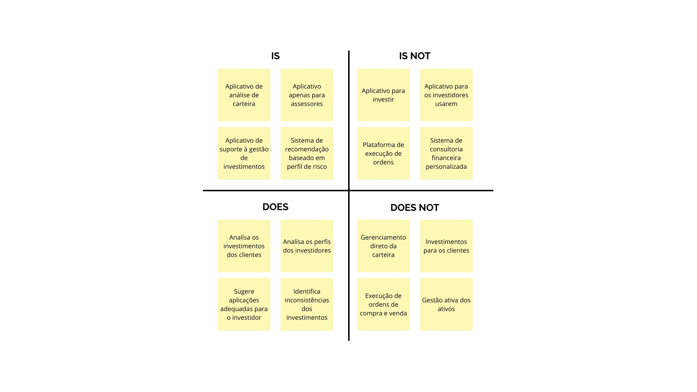
<br>
<br>
<sup>Fonte: Material produzido pelos autores (2025)</sup>
</div>
<br>

## 2.4 Personas e Jornada do Usuário

&emsp;A definição de personas e a construção das respectivas jornadas de usuário são etapas fundamentais no processo de design centrado no ser humano. Elas ajudam a guiar as decisões de desenvolvimento, garantindo que o produto atenda de forma eficaz às reais necessidades dos usuários finais.

&emsp;Por outro lado, a jornada é  uma ferramenta  para visualizar, de forma estruturada, o caminho percorrido por uma persona durante sua rotina com (ou sem) a aplicação em desenvolvimento. Ela tem como objetivo revelar pontos críticos de interação do usuário com o sistema. 

&emsp;Para garantir a compreensão completa da jornada aplicada, uma breve descrição das seções pode se fazer importante.

<div align="center">
<sub>Figura x - Jornada do usuário - Guia</sub>
  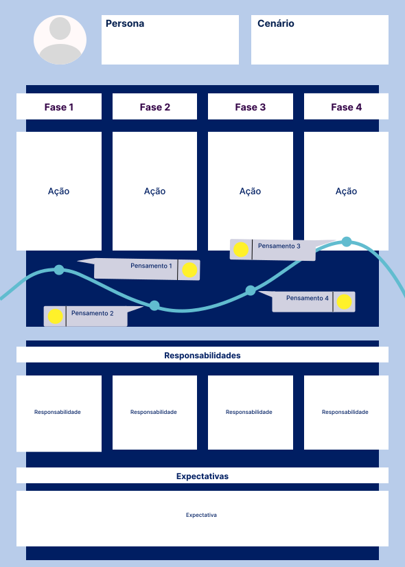
<sup>Fonte: Material produzido pelos autores (2025)</sup>
</div>

**Fases + Ações:** representam o fluxo da rotina do usuário, indicando o que ele faz, como age e com que frequência. São ações reais que ajudam a localizar o papel da aplicação no cotidiano do usuário.

**Cenário:** descreve o contexto vivido pela persona em determinado momento da sua jornada. Ele fornece o pano de fundo que influencia suas decisões.

**Pensamentos:** expressam o que passa pela mente da persona em cada etapa: dúvidas, receios, certezas e prioridades.

**Expectativas:** indicam o impacto desejado da solução digital na rotina da persona, ou seja, quais mudanças pretendemos gerar com o sistema e como esperamos melhorar sua experiência de vida ou trabalho.

**Responsabilidades:** são pontos que destacam aquilo que nós, enquanto equipe de desenvolvimento, devemos garantir para entregar uma solução funcional e relevante.

**Oportunidades:** sintetizam as chances reais de melhorar a vida do usuário com base no cenário apresentado. Estão diretamente ligadas às ações e fases mapeadas e nos ajudam a entender onde e como podemos intervir para gerar valor.

### Persona Assessor

&emsp;Para representar o papel do assessor de investimentos neste projeto, foi desenvolvida a persona Fábio Betège, que assume o papel central na experiência com o sistema. Essa persona foi definida com base em padrões comportamentais reais e necessidades observadas no cotidiano desses profissionais.

&emsp;O assessor é considerado o usuário principal da aplicação, visto que será diretamente impactado pelas funcionalidades, fluxos e pela usabilidade da plataforma. O objetivo ao mapear essa persona é garantir que o sistema entregue valor real e mensurável para o assessor, otimizando sua rotina profissiona.

<div align="center">
<sub>Figura x - Jornada do usuário - Guia</sub>

<sup>Fonte: Material produzido pelos autores (2025)</sup>
</div>

&emsp;A análise da persona, realizada em conjunto com o parceiro de negócios, revelou comportamentos recorrentes — como a realização de reuniões bimestrais com os clientes. Esse tipo de informação orientou também a discussão sobre funcionalidades que facilitem o planejamento e execução dessas interações, considerando inclusive a adaptação da comunicação conforme a faixa etária dos investidores atendidos.

### Persona Cliente

&emsp;Foi desenvolvida a persona secundária Mariana Rocha, que representa o cliente final atendido pelo assessor Fábio. Embora não utilize diretamente a aplicação, Mariana permite analisar os impactos indiretos da plataforma sobre a experiência do cliente, o que contribui para refinar ainda mais as funcionalidades voltadas ao trabalho do assessor.

<div align="center">
<sub>Figura x - Jornada do usuário - Guia</sub>

<sup>Fonte: Material produzido pelos autores (2025)</sup>
</div>

&emsp;Ao estudar essa persona, foi possível ampliar a compreensão sobre o relacionamento entre cliente e assessor, percebendo que ele ocorre de forma contínua por meio de canais informais como WhatsApp e ligações telefônicas. 

&emsp;Durante o processo de construção da Mariana, também ficou evidente a dificuldade de representar um perfil único de cliente. O público atendido por assessores é extremamente diverso em aspectos como idade, grau de instrução, familiaridade com finanças e objetivos de investimento. Assim, Mariana foi concebida como um recorte representativo entre muitos possíveis, e suas características — como sua formação acadêmica ou nível de conhecimento em economia — não devem ser tomadas como generalizáveis a todos os clientes.

### Jornada de Usuário do Assessor

&emsp;Antes da existência da aplicação, Fábio enfrenta um processo majoritariamente manual e descentralizado no relacionamento com seus clientes, dificultando o acompanhamento do perfil de seus clientes.

<div align="center">
<sub>Figura x - Jornada do Assessor - Antes da Solução</sub>
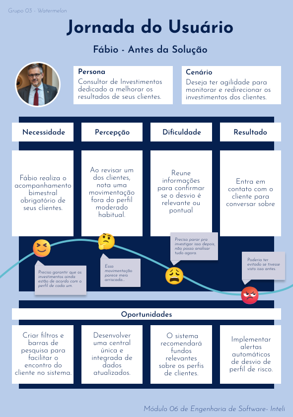
<sup>Fonte: Material produzido pelos autores (2025)</sup>
</div>

&emsp;Com a implementação da plataforma, o acompanhamento do assessor em relação aos seus clientes é significativamente agilizada, por meio de ferramentas inteligentes que emitem alertas sempre que o perfil de investimento do cliente se desvia do esperado.

<div align="center">
<sub>Figura x - Jornada do Assessor - Depois da Solução</sub>
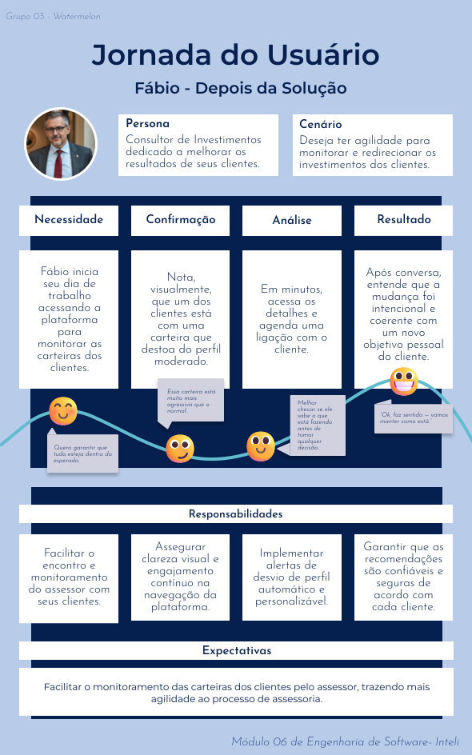
<sup>Fonte: Material produzido pelos autores (2025)</sup>
</div>

&emsp;Com isso, entendemos que a missão do nosso software não é reinventar a rotina do assessor, mas torná-la mais ágil, eficiente e inteligente. O objetivo da solução é reduzir o tempo gasto em tarefas operacionais, como o monitoramento de carteira e o preparo de reuniões, e aumentar o foco em interações estratégicas com os clientes.

### Jornada de Usuário do Cliente

&emsp;Antes da implementação da plataforma, Mariana contava com um acompanhamento de qualidade por parte de seu assessor. No entanto, a grande quantidade de clientes sob responsabilidade do profissional fazia com que houvesse um intervalo considerável entre a percepção de uma mudança no comportamento de Mariana e a tomada de ação para corrigi-la.

&emsp;Mesmo com boas intenções e processos funcionais, esse _gap_ de tempo abria margem para que Mariana, sem perceber, se desviasse do seu perfil de investidora original, o que poderia comprometer sua estratégia financeira de longo prazo. 

<div align="center">
<sub>Figura x - Jornada do Cliente - Depois da Solução</sub>
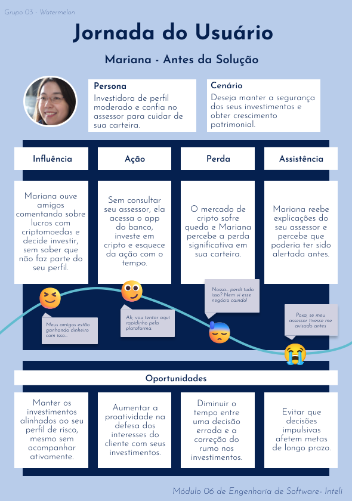
<sup>Fonte: Material produzido pelos autores (2025)</sup>
</div>

&emsp;Com a aplicação em funcionamento, Mariana passa a contar com um acompanhamento mais proativo e inteligente. A plataforma oferece recursos que alertam o assessor quando há mudanças no comportamento ou perfil da cliente, permitindo que ele intervenha com agilidade.

&emsp;Isso fortalece o vínculo entre assessor e cliente e garante que decisões mais críticas possam ser tomadas rapidamente — reduzindo os riscos e reforçando a sensação de segurança da Mariana diante de variações no mercado.

<div align="center">
<sub>Figura x - Jornada do Cliente - Depois da Solução</sub>
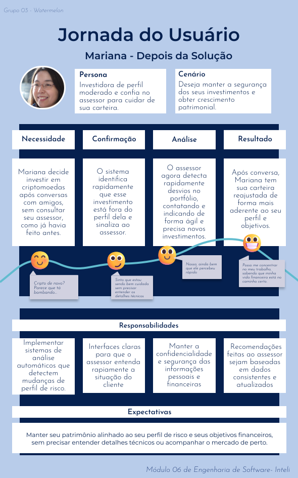
<sup>Fonte: Material produzido pelos autores (2025)</sup>
</div>

&emsp;A principal mudança está na redução do tempo de resposta entre o assessor e sua cliente. A plataforma atua como uma ponte que fecha esse _gap_, tornando a assessoria mais eficiente e personalizada.
Para o parceiro de negócios, o valor gerado está na capacidade de escalar um atendimento ágil e de qualidade, mesmo com uma grande carteira de clientes. Para o cliente final, como Mariana, isso se traduz em mais segurança, confiança e aderência ao planejamento financeiro traçado.

## 2.5 Modelagem do Fluxo de Negócio

&emsp;Realizar a modelagem dos fluxos de negócio permite compreender como as atividades se organizam atualmente e como podem ser otimizadas com a solução proposta. Nesta seção, são apresentados o mapeamento da cadeia de valor, o fluxo atual (AS-IS) e o fluxo futuro desejado (TO-BE), evidenciando ganhos operacionais, pontos críticos e oportunidades de automação que sustentam o valor da proposta para o parceiro.

## 2.5.1 Cadeia de Valor

&nbsp;&nbsp; Esta seção detalha a cadeia de valor do aplicativo de verificação de perfil de investidor desenvolvido para o BTG Pactual. O objetivo é mapear e compreender as principais atividades envolvidas na geração de valor para o cliente, desde a entrada de dados até a entrega de uma análise precisa de conformidade regulatória. A estrutura apresentada considera os processos principais, de suporte e de gestão, bem como os indicadores de desempenho e o alinhamento com o ciclo de BPM (Business Process Management).

### Cadeia de Valor – App de Verificação de Perfil de Investidor (BTG Pactual)

&nbsp;&nbsp; O processo principal inicia com a importação dos dados de clientes e suas carteiras de ativos. Esses dados alimentam o classificador automático do aplicativo, que calcula o perfil do investidor com base na regulamentação da CVM (Resolução 175). A seguir, o sistema compara esse perfil calculado com o perfil cadastrado, apontando divergências e sugerindo readequações. Todo esse fluxo é apresentado de forma visual em um painel interativo, facilitando a análise e a tomada de decisão. O objetivo final é garantir a aderência entre o portfólio do cliente e seu perfil, promovendo transparência, governança e segurança regulatória.

---

#### Principais etapas do processo:
- Importação de dados via CSV, XLSX ou API  
- Classificação automática do perfil de investidor conforme a CVM 175  
- Verificação de conformidade entre o perfil cadastrado e o calculado  
- Geração de recomendações de ajuste por cliente  
- Exibição em painel visual com filtros por risco, categoria e status  

---

#### Processos de suporte:
- Infraestrutura de TI segura e escalável para garantir confidencialidade e desempenho  
- Interpretação jurídica das normas regulatórias para assegurar aderência normativa  
- Gestão dos dados com controle de acesso, backup e integridade  

---

#### Processos de gestão:
- Coordenação estratégica do projeto com definição de escopo, entregáveis e cronograma  
- Matriz RACI com papéis bem definidos entre stakeholders  
- Monitoramento da performance do sistema, análise de conformidade e coleta de feedback  

---

#### Indicadores de valor (KPI's sugeridos):
- Redução no número de descasamentos de perfil por cliente  
- Tempo médio de verificação de conformidade antes e depois do uso do app  
- Taxa de conformidade regulatória das carteiras monitoradas  
- Nível de confiança percebido pelo cliente (em pesquisas internas)  

---

#### Valor para o cliente/investidor:
- Mais segurança e transparência no alinhamento entre seu perfil e seus investimentos  
- Acesso facilitado às informações sobre adequação da carteira  
- Redução do risco de investir em produtos incompatíveis com seu perfil  
- Fortalecimento da relação com o BTG por meio de uma experiência digital confiável  

---

#### Relação com o ciclo de BPM:
- **Descoberta do processo**: mapeamento da jornada de verificação de perfil  
- **Análise**: identificação de falhas nos processos manuais ou desatualizados  
- **Redesenho**: automação com base nas regras da CVM  
- **Implementação**: desenvolvimento e testes do app com dados simulados  
- **Monitoramento**: uso de painéis com indicadores de conformidade por cliente  

---

#### Potencial de expansão e integração futura:
- Integração com sistemas internos do BTG, como CRM e plataformas de alocação  
- Criação de APIs para validação externa por entidades ou auditores  
- Escalabilidade para avaliação de outros produtos financeiros ou perfis avançados  

---

<br>
<div align="center">
<sub>Figura x - Cadeia de valor</sub>
<br>
<br>
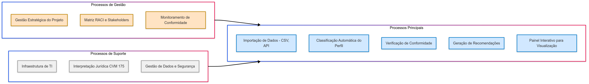
<br>
<br>
<sup>Fonte: Material produzido pelos autores (2025)</sup>
</div>
<br>

&nbsp;&nbsp; A análise da cadeia de valor demonstra como o aplicativo entrega benefícios tangíveis tanto para o cliente quanto para o BTG Pactual, promovendo conformidade regulatória, eficiência operacional e uma experiência digital confiável. Ao automatizar e visualizar o processo de verificação do perfil de investidor, a solução contribui para decisões mais seguras e alinhadas, além de abrir caminho para integrações e expansões futuras que aumentam ainda mais seu impacto estratégico.

## 2.5.2 Fluxo de Negócio Proposto (AS-IS e TO-BE)


A modelagem dos fluxos de negócio AS-IS e TO-BE, apresentada a seguir via BPMN, é fundamental para visualizar as limitações do processo atual e o valor agregado pela solução proposta.

[Link de acesso aos fluxos no Miro](https://miro.com/app/board/uXjVIGy2aYQ=/?share_link_id=918758245621)

**Fluxo AS-IS (Processo Atual):**
<div align="center">
<sup>Figura X - Fluxo de Negócios Atual</sup>
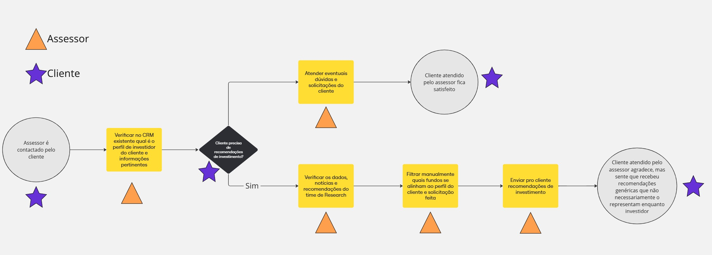
<sub>Fonte: Material produzido pelos autores (2025).</sub>
</div>
<br>
O fluxo atual de recomendação e adequação de investimentos depende significativamente da análise manual do assessor. Este processo apresenta desafios como:

* **Contexto Limitado:** O assessor muitas vezes opera com informações de perfil do investidor que podem não refletir completamente a adequação da carteira atual do cliente às normativas vigentes da CVM (como a Resolução 175).
* **Análise Manual Intensiva:** A verificação da adequação e a filtragem de produtos compatíveis são realizadas manualmente, consumindo tempo e tornando difícil garantir consistência e personalização em escala.
* **Risco de Desalinhamento:** Há um risco inerente de desalinhamento entre o perfil formal do cliente e sua carteira real, o que pode levar a problemas de conformidade regulatória e suitability.
<br>
---

**Fluxo TO-BE (Processo Proposto com a Solução):**
<div align="center">
<sup>Figura X - Fluxo de Negócios Atual</sup>
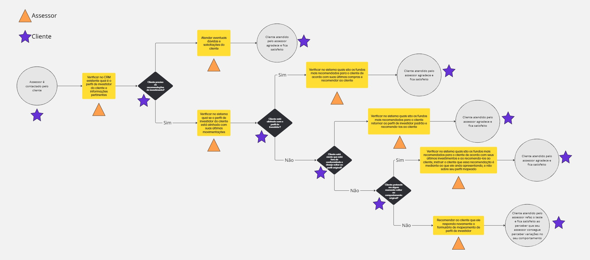
<sub>Fonte: Material produzido pelos autores (2025).</sub>
</div>
<br>
A introdução do aplicativo móvel redesenha o fluxo de negócio para superar as limitações atuais. Os principais ganhos incluem:


* **Recomendações Contextualizadas:** A solução considera o histórico do cliente e utiliza filtros para sugerir ajustes ou novas recomendações de investimento que sejam verdadeiramente personalizadas e aderentes ao perfil de risco e objetivos do investidor.
* **Proatividade e Eficiência:** O assessor ganha eficiência com a automação da análise e pode atuar de forma mais proativa na gestão da carteira dos clientes, apoiado por informações e sugestões geradas pelo sistema.
* **Adequação com Interesse REAL do cliente:** Facilita no processo de retorno ao perfil de investidor do cliente. Caso um cliente tenha feitos investimentos fora do seu feitio de maneira pontual, o sistema entrega produtos que vão de encontro com seu perfil original, caso seja de interesse do cliente.


## 2.6 Matriz de Risco do Projeto

&emsp;Durante o planejamento inicial do projeto, foi realizada uma análise dos principais riscos que poderiam comprometer a entrega da solução, considerando tanto a probabilidade de ocorrência, quanto o impacto de cada situação sobre o andamento e a efetividade do aplicativo.

<div align="center">
<sub>Figura x - Matriz de riscos</sub><br>
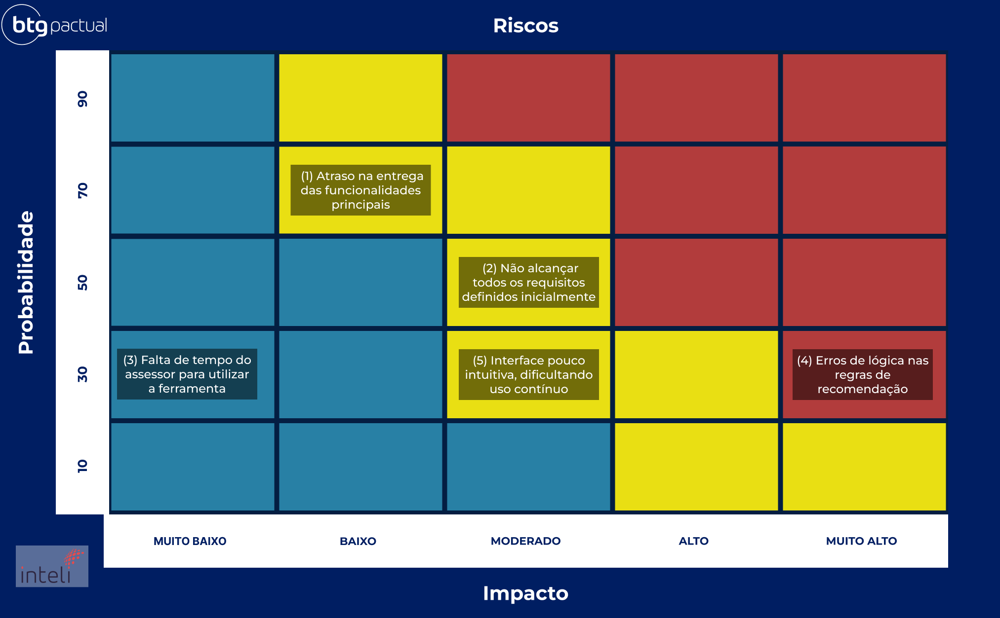<br>
<sup>Fonte: Material produzido pelos autores (2025) </sup>
</div>

&emsp;Entre os riscos com maior criticidade está a possibilidade de erros nas regras de lógica do sistema de recomendação, o que comprometeria diretamente a confiabilidade da ferramenta perante os assessores. Como possíveis ações para mitigar esse risco, planejam-se ser implementados testes automatizados e revisões constantes da lógica com apoio técnico especializado e dados simulados quando necessário.

&emsp;Outro ponto relevante é o risco de não alcançar todos os requisitos inicialmente definidos, dado o escopo amplo e o tempo restrito de desenvolvimento. Essa preocupação será enfrentada por meio de uma abordagem incremental, com foco nas funcionalidades prioritárias validadas junto ao parceiro. Ainda em termos de cronograma, o risco de atraso na entrega das funcionalidades principais foi mapeado como relevante, podendo ser mitigado por meio do mantimento da organização ágil do time durante as Sprints.

&emsp;No que diz respeito à experiência do usuário, foi identificada a possibilidade de uma interface pouco intuitiva dificultar o uso contínuo da ferramenta. Para reduzir esse risco, serão conduzidos testes de usabilidade e sessões de co-criação com stakeholders ao longo do desenvolvimento. Já o risco de baixa adesão por falta de tempo do assessor foi considerado de baixo impacto, mas ainda assim será endereçado com uma interface enxuta, rápida e com curva de aprendizado reduzida.

&emsp;Essa análise de riscos contribui para uma gestão de projeto mais iterativa, estratégica e preventiva, permitindo que as decisões técnicas e de design estejam alinhadas aos desafios reais da operação e às expectativas dos usuários finais.

## 2.7 Ideação

&emsp;Neste estágio inicial de planejamento da aplicação, foi feito um *brainstorm* de funcionalidades que podem ser oferecidas pelo sistema, sendo alinhadas com o entendimento do negócio e do projeto. Foram elencadas 10 funcionalidades, listadas por esforço e prioridade em relação às necessidades do BTG Pactual e o prazo de desenvolvimento da solução.

### Brainstorm de Features

| # | Feature | Descrição | Prioridade | Esforço |
|:---|:---|:---|:---| :---|
| 1 | Leitura de carteira | Leitura de componentes de carteira de investimentos | Alta | Médio/baixo |
| 2 | Análise de Conformidade da Carteira | Avaliação automática se a carteira está adequada ao perfil de risco do cliente. | Alta | Médio |
| 3 | Recomendação de Readequação de Perfil | Caso detectada divergência, gerar sugestão de novo perfil do cliente ao assessor. | Alta | Alto |
| 4 | Cálculo de Peso dos Ativos na Carteira | Cálculo ponderado dos tipos de investimento para identificação do perfil. | Alta | Médio |
| 5 | Painel de Visualização de Conformidade | Página para os assessores visualizarem status de todas as carteiras (adequadas ou não). | Alta | Médio |
| 6 | Filtro por Necessidade de Realocação | Recurso de filtragem por carteiras divergentes com grupo de risco original, que resultará na listagem de carteiras com necessidade de realocação de perfil. | Alta | Médio |
| 7 | Filtro por Segmento | Permitir ao usuário filtrar os clientes por segmento (exemplo: Prata, Ouro, Platinum). | Média | Baixo |
| 9 | Histórico de Readequações de Perfil | Registro das mudanças/sugestões de perfil ao longo do tempo para cada cliente. | Média | Alto |
| 10 | Visualização de Pesos dos Ativos | Exibição visual de distribuição percentual por classe de ativos (gráfico pizza/barras). | Baixa | Médio |

&emsp;Dessa forma, a ideação de features foi um passo importante para discussão e concretização de ideias iniciais a serem concretizadas como decisões da equipe. Além disso, a ideação orientará a elaboração dos Requisitos Funcionais e Não Funcionais, base do desenvolvimento do projeto.

## 2.8 Canvas do Projeto


&nbsp;&nbsp;&nbsp;&nbsp;O Canvas MVP é uma ferramenta visual utilizada para estruturar, de forma rápida e simples, os principais elementos de um MVP (Mínimo Produto Viável). O seu objetivo é alinhar a equipe quanto à proposta da solução, as funcionalidades prioritárias, os públicos-alvo atendidos, jornadas de usuário, expectativas e métricas que validarão as hipóteses do negócio.

&nbsp;&nbsp;&nbsp;&nbsp;Segue abaixo, o canvas MVP da aplicação web desenvolvido a partir das atividades realizadas durante o workshop com o parceiro.

<div align="center">
<sub>Figura x - Canvas MVP do projeto</sub><br>
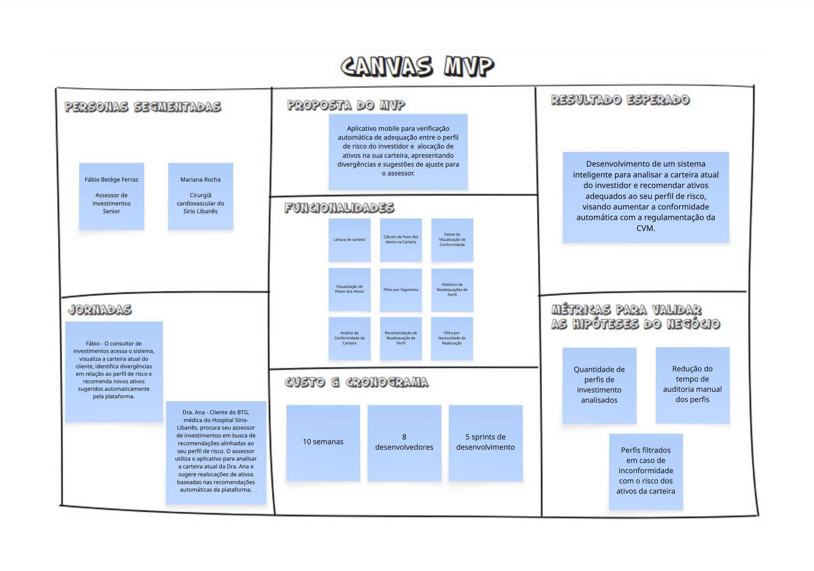<br>
<sup>Fonte: Material produzido pelos autores (2025) </sup>
</div>

## 2.9 Estimativa de Investimento

&emsp;O texto à seguir, apresenta uma estimativa de investimento para o desenvolvimento e manutenção, pelo período de 1 ano, de um aplicativo de suporte à análise de carteiras de investimento, destinado aos assessores do banco de investimento BTG Pactual.

&emsp;O foco da estimativa considera um perfil de custo padrão, utilizando informações atualizadas do mercado (abril de 2025), levando em conta salários médios da área de tecnologia, custos de software e preços de infraestrutura em nuvem.

&emsp;A seguir são detalhados os valores estimados para o desenvolvimento e manutenção do projeto durante 12 meses, considerando as categorias da Pessoas, Software e Infraestrutura.

### Pessoas
| Cargo                   | Salário Mensal (R$) | Quantidade | Custo em 12 meses (R$) |
|-------------------------|---------------------|------------|------------------------|
| Gestor do Projeto       | 10.000              | 1          | 120.000                |
| Desenvolvedor Backend   | 8.000               | 3          | 192.000                |
| Desenvolvedor Frontend  | 7.000               | 2          | 168.000                |
| UX/UI Designer          | 6.000               | 1          | 36.000                 |
| Product Owner (PO)      | 10.000              | 1          | 60.000                 |
| Analista de QA          | 6.500               | 1          | 39.000                 |
| **Total Pessoas**       |                     |            | **615.000**            |

### Software
| Item                               | Custo Mensal (R$) | Custo em 12 meses (R$) |
|------------------------------------|-------------------|------------------------|
| Licença Figma Professional (UX/UI) | 80                | 960                    |
| IDE JetBrains (ex: WebStorm)       | 40                | 480                    |
| API Externa (se necessário)        | 200               | 2.400                  |
| Plataforma GitHub Teams            | 20                | 240                    |
| **Total Software**                 |                   | **4.080**              |

### Infraestrutura
| Item                                               | Custo Mensal (R$) | Custo em 12 meses (R$) |
|----------------------------------------------------|-------------------|------------------------|
| AWS EC2 (2 Instâncias Médias com Auto Scaling)     | 1.200             | 14.400                 |
| AWS RDS (Banco de Dados Alta Disponibilidade)      | 800               | 9.600                  |
| AWS S3 (Storage com Redundância)                   | 200               | 2.400                  |
| Load Balancer + CloudFront (Distribuição global)   | 300               | 3.600                  |
| Certificado SSL + Domínio + DNS Gerenciado         | 100               | 1.200                  |
| Monitoramento e Alertas (Datadog, UptimeRobot Pro) | 300               | 3.600                  |
| Backup Automático e Logs Centralizados (CloudWatch)| 200               | 2.400                  |
| **Total Infraestrutura**                           |                   | **37.200**             |


### Custo Total Estimado
| Categoria        | Total (R$) |
|------------------|------------|
| Pessoas          | 615.000    |
| Software         | 4.080      |
| Infraestrutura   | 37.200     |
| **Total Geral**  | **656.280** |

&emsp;A estimativa de investimento apresentada acima foi construída com base em valores de mercado atualizados até o mês de abril de 2025, considerando a realidade brasileira para o setor de tecnologia e desenvolvimento de software. Os profissionais de UX/UI Designer, Product Owner e Analista de QA estão alocados em meio período no projeto, o que justifica o salário proporcional.

# 3. Requisitos do Projeto
&emsp;Esta seção tem como objetivo identificar, organizar e descrever os requisitos do sistema proposto, com base na análise do problema, nas necessidades do parceiro BTG Pactual e nas expectativas dos principais usuários do sistema (personas Fábio e Mariana).

&emsp;Os requisitos aqui definidos norteiam o desenvolvimento do aplicativo e garantem que o produto final atenda às funcionalidades esperadas, bem como aos atributos de qualidade exigidos em um contexto sensível, que envolve dados financeiros e adequação regulatória.

&emsp;O conjunto de requisitos foi dividido em:

&emsp;Requisitos Funcionais (RFs): descrevem as funcionalidades específicas que o sistema deve executar para atingir seus objetivos, representadas por user stories vinculadas às personas.

&emsp;Requisitos Não Funcionais (RNFs): especificam as restrições, qualidades e condições que o sistema deve atender, com base nos atributos do modelo ISO/IEC 25010, tais como desempenho, segurança, manutenibilidade e usabilidade.

&emsp;Além disso, apresenta-se uma correlação entre os RFs e os RNFs, visando garantir a rastreabilidade entre as funcionalidades e os critérios de qualidade, assegurando a confiabilidade e consistência ao produto.

## 3.1 Requisitos Funcionais (RFs)

&emsp;Os Requisitos Funcionais (RFs) representam as funcionalidades que o sistema deve obrigatoriamente oferecer para atender às necessidades dos usuários e alcançar os objetivos de negócio. Eles descrevem o comportamento esperado do sistema diante de diferentes interações e contextos de uso, definindo claramente "o que" o sistema deve fazer. Neste projeto, os RFs foram derivados das features propostas, refinados por meio das personas e descritos tanto tecnicamente quanto na forma de user stories.

<div align="center">
<sub>Tabela X - Requisitos funcionais</sub><br>

| RF#   | Descrição                                                                                                                                      | Prioridade |
|-------|------------------------------------------------------------------------------------------------------------------------------------------------|------------|
| RF01  | O sistema deve importar e processar automaticamente os dados de carteira de clientes por meio de integração via API.                                         | Alta       |
| RF02  | O sistema deve calcular automaticamente o perfil de risco com base nos ativos da carteira.                                                    | Alta       |
| RF03  | O sistema deve verificar a conformidade entre o perfil calculado e o perfil cadastrado do cliente.                                            | Alta       |
| RF04  | O sistema deve exibir recomendações de readequação do perfil quando for identificado um desalinhamento.                                       | Alta       |
| RF05  | O sistema deve apresentar, de forma visual, o status de conformidade de todas as carteiras em um painel.                                      | Alta       |
| RF06  | O sistema deve oferecer filtros por status de conformidade (adequado/não adequado).                                                           | Média      |
| RF07  | O sistema deve permitir filtro de clientes por segmento (Prata, Ouro, Platinum).                                                              | Média      |
| RF08  | O sistema deve manter o histórico das sugestões de readequação de perfil por cliente.                                                         | Média      |
| RF09  | O sistema deve exibir graficamente a composição da carteira por tipo de ativo.                                                                | Baixa      |

<sup>Material produzido pelos autores (2025)</sup>
</div><br>

### Requisitos Funcionais Definidos como User Stories

<div align="center">
<sub>Tabela X - User Stories dos Requisitos Não Funcionais</sub><br>

| ID    | User Story |
|-------|------------|
| RF01  | Como Fábio, quero importar automaticamente os dados das carteiras de meus clientes via API, para garantir rapidez e integração contínua com os sistemas internos. |
| RF02  | Como Fábio, quero que o sistema calcule o perfil do cliente com base na carteira, para identificar facilmente desalinhamentos. |
| RF03  | Como Fábio, quero verificar se a carteira está aderente ao perfil cadastrado, para evitar riscos regulatórios. |
| RF04  | Como Fábio, quero sugestões automáticas de readequação de perfil, para apresentar ao cliente opções seguras rapidamente. |
| RF05  | Como Fábio, quero visualizar todas as carteiras em um painel com seus status, para identificar rapidamente onde intervir. |
| RF06  | Como Fábio, quero filtrar apenas carteiras fora do perfil, para focar nas situações que exigem ação imediata. |
| RF07  | Como Fábio, quero filtrar meus clientes por segmento, para priorizar atendimentos estratégicos. |
| RF08  | Como Fábio, quero visualizar o histórico de readequações sugeridas, para acompanhar decisões anteriores e justificar recomendações. |
| RF09  | Como Mariana, quero ver a distribuição da minha carteira por tipo de ativo de forma clara, para entender rapidamente onde estou investindo. |

<sup>Material produzido pelos autores (2025)</sup>
</div><br>

### Tabela de Testes para Requisitos Funcionais

<div align="center">
<sub>Tabela X - Testes associados aos Requisitos Funcionais</sub><br>

| Caso de Teste | RF#   | Descrição do Teste                                                                                      | Pré-condição                                                                 | Caso de Aceite                                                                                   | Caso de Recusa                                                                                   |
|---------------|-------|---------------------------------------------------------------------------------------------------------|------------------------------------------------------------------------------|--------------------------------------------------------------------------------------------------|--------------------------------------------------------------------------------------------------|
| CT-RF01       | RF01  | Testar importação automática de uma carteira via integração de API.                                   | Arquivo válido em formato CSV/XLSX presente no sistema.                      | Dados são processados corretamente e exibidos no sistema.                                        | Erro ao processar arquivo ou ausência de resposta do sistema.                                   |
| CT-RF02       | RF02  | Testar cálculo do perfil com base na composição da carteira de um cliente.                              | Carteira do cliente carregada com ativos e pesos.                            | Sistema calcula e exibe o perfil de risco com base nos ativos.                                  | Perfil não calculado ou resultado inconsistente com os dados.                                   |
| CT-RF03       | RF03  | Verificar conformidade entre o perfil calculado e o perfil cadastrado.                                  | Perfil cadastrado e carteira disponíveis no sistema.                         | Sistema exibe mensagem indicando se o cliente está ou não conforme.                             | Sistema não exibe resultado ou mostra status incorreto.                                          |
| CT-RF04       | RF04  | Testar geração de recomendações para perfis não conformes.                                               | Cliente fora do perfil e perfil calculado já disponível.                     | Sistema exibe sugestão de readequação de perfil.                                                 | Nenhuma sugestão é apresentada ou mensagem incorreta.                                            |
| CT-RF05       | RF05  | Visualizar painel com status de conformidade das carteiras dos clientes.                                | Base de clientes carregada e analisada.                                      | Painel exibe lista de clientes e status visual de conformidade.                                 | Painel vazio, incompleto ou com dados incorretos.                                                |
| CT-RF06       | RF06  | Aplicar filtro para exibir apenas carteiras fora do perfil.                                             | Base de dados com clientes em diferentes estados de conformidade.            | Lista é filtrada corretamente para mostrar apenas os casos não conformes.                       | Filtro não funciona ou exibe resultados incorretos.                                              |
| CT-RF07       | RF07  | Aplicar filtro por segmento (Prata, Ouro, Platinum).                                                    | Clientes cadastrados com segmentação definida.                              | Sistema filtra e exibe clientes corretamente por segmento.                                       | Lista incorreta ou ausência de filtragem.                                                        |
| CT-RF08       | RF08  | Verificar exibição do histórico de sugestões de readequação por cliente.                                | Cliente com histórico de sugestões anteriores no sistema.                    | Sistema exibe linha do tempo ou registros anteriores com clareza.                               | Histórico ausente ou incompleto.                                                                 |
| CT-RF09       | RF09  | Testar visualização gráfica da composição da carteira por tipo de ativo.                                | Carteira importada com ativos e classificações definidas.                   | Gráfico (pizza, barras) é exibido corretamente com dados proporcionais.                         | Gráfico ausente, distorcido ou com dados incorretos.                                             |

<sup>Fonte: Material produzido pelos autores (2025)</sup>
</div>

## 3.2 Requisitos Não Funcionais (RNFs)

&emsp;Os Requisitos Não Funcionais (RNFs) especificam as qualidades e restrições que o sistema deve respeitar, como desempenho, segurança, usabilidade, manutenibilidade, entre outros. Diferentemente dos RFs, os RNFs não dizem respeito ao comportamento direto do sistema, mas à forma como esse comportamento deve ser entregue. Neste projeto, os RNFs foram definidos com base nas diretrizes da norma ISO/IEC 25010 e abordam critérios técnicos essenciais para garantir robustez, escalabilidade e boa experiência de uso.

<div align="center">
<sub>Tabela X - Requisitos não funcionais</sub><br>


| **RNF#** | **Descrição**                                                                                                                   | **Aspecto de Qualidade (ISO 25010)** | **Prioridade** |
|---------|-----------------------------------------------------------------------------------------------------------------------------------|--------------------------------------|----------------|
| RNF01   | O sistema deve responder às requisições de recomendação baseadas em machine learning em até 2 segundos, mesmo sob condições normais de operação. | Desempenho e Eficiência              | Média          |
| RNF02   | O sistema deve suportar pelo menos 3.000 acessos simultâneos, mantendo o tempo de resposta médio de requisições padrão (não-ML) abaixo de 1 segundo por requisição. | Desempenho e Eficiência              | Média          |
| RNF03   | O sistema deve ser containerizado com Docker e projetado para rodar exclusivamente em ambientes de nuvem, garantindo portabilidade e escalabilidade. | Portabilidade                        | Alta           |
| RNF04   | O app deve ser desenvolvido exclusivamente para Android (versão 10 ou superior).                                                 | Compatibilidade                      | Baixa          |
| RNF05   | O sistema deve usar APIs RESTful bem documentadas e versionadas através do Swagger, com autenticação via provedor de terceiros (ex: Auth0 ou Firebase), garantindo segurança e compatibilidade entre os componentes. | Compatibilidade                      | Média          |
| RNF06   | A estrutura do aplicativo deve ser organizada de forma modular, com responsabilidades claras e desacopladas entre os componentes, permitindo a evolução do código com baixo impacto em outras partes do sistema. | Manutenibilidade                     | Alta           |
| RNF07   | O sistema de recomendação (ML) deve rodar em infraestrutura separada do backend do app, sendo acessado exclusivamente via API. Essa separação deve permitir manutenção independente entre os dois sistemas. | Manutenibilidade                     | Alta           |
| RNF08   | A comunicação entre o app, o backend e o sistema de recomendação deve ser feita via HTTPS com TLS 1.2 ou superior.               | Segurança                            | Alta           |
| RNF09   | A autenticação de acesso ao app deve ser feita com uso de autenticação multifator (MFA).                                         | Segurança                            | Baixa          |
| RNF10   | Dados sensíveis eventualmente armazenados localmente devem estar criptografados utilizando criptografia simétrica forte.         | Segurança                            | Alta           |
| RNF11   | Em falha do sistema de recomendação, o app deve mostrar mensagem clara e oferecer ao menos 1 sugestão padrão, além de opção para tentar novamente. | Confiabilidade                       | Alta           |
| RNF12   | O sistema deve ter disponibilidade de no mínimo 99,5% mensal.                                                                    | Confiabilidade                       | Baixa          |
| RNF13   | O modelo de Machine Learning deve ser re-treinado automaticamente com base em indicadores matemáticos de variação dos dados e/ou de desempenho, de forma a garantir sua atualização eficiente.                    | Funcionalidade Adequada              | Baixa          |
| RNF14   | A exibição das recomendações deve seguir boas práticas de usabilidade (como as heurísticas de Nielsen) e ser validada com testes de usabilidade com usuários reais. | Usabilidade                          | Média          |

<sup>Material produzido pelos autores (2025)</sup>
</div><br>

### Requisitos Não Funcionais Definidos como User Stories

<div align="center">
<sub>Tabela X - User Stories dos Requisitos Não Funcionais</sub><br>

| **ID**  | **User Story** |
|---------|------------------------------------------------------------------------------------------------------------------------------------------------------------------------------------------------|
| RNF01   | Como Fábio, quero que as recomendações baseadas em machine learning sejam respondidas em até 2 segundos, para garantir uma experiência rápida e eficiente durante o uso cotidiano. |
| RNF02   | Como Fábio, quero que o sistema suporte pelo menos 3.000 acessos simultâneos, mantendo o tempo médio de resposta abaixo de 1 segundo, para garantir estabilidade e rapidez mesmo em horários de pico. |
| RNF03   | Como administrador do sistema, quero que a aplicação seja containerizada com Docker e executada exclusivamente em ambientes de nuvem, para garantir portabilidade e escalabilidade. |
| RNF04   | Como Fábio, quero que o app esteja disponível apenas para Android versão 10 ou superior, para garantir compatibilidade com dispositivos modernos. |
| RNF05   | Como desenvolvedor, quero que o sistema utilize APIs RESTful bem documentadas e versionadas via Swagger, com autenticação de terceiros, para facilitar a integração segura e manter a compatibilidade entre componentes. |
| RNF06   | Como desenvolvedor, quero que o aplicativo tenha uma estrutura modular e com responsabilidades bem definidas, para facilitar a manutenção e evolução do código com baixo impacto. |
| RNF07   | Como administrador do sistema, quero que o sistema de recomendação de ML rode em infraestrutura separada e seja acessado apenas via API, para permitir manutenção e atualizações independentes entre os sistemas. |
| RNF08   | Como Fábio, quero que toda comunicação entre app, backend e sistema de recomendação seja feita através de HTTPS com TLS 1.2 ou superior, para garantir a segurança dos dados transmitidos. |
| RNF09   | Como Fábio, quero autenticação multifator (MFA) no acesso ao app, para aumentar a segurança da minha conta. |
| RNF10   | Como Fábio, quero que dados sensíveis armazenados localmente sejam criptografados com uma criptografia simétrica forte, para proteger minhas informações mesmo em caso de perda ou roubo do dispositivo. |
| RNF11   | Como Fábio, quero que o app exiba uma mensagem clara e forneça uma sugestão padrão caso o sistema de recomendação falhe, para que eu possa continuar usando o app sem frustração. |
| RNF12   | Como Fábio, quero que o sistema esteja disponível no mínimo 99,5% do tempo mensal, para garantir que o serviço esteja quase sempre acessível quando eu precisar. |
| RNF13   | Como Fábio, quero que o modelo de ML seja re-treinado automaticamente baseado em variação de dados e desempenho, para manter a qualidade e atualidade das recomendações. |
| RNF14   | Como Fábio, quero que a exibição das recomendações siga boas práticas de usabilidade e seja validada com testes reais, para que a interface seja intuitiva e fácil de usar. |


<sup>Material produzido pelos autores (2025)</sup>
</div><br>


### Tabela de Testes para Requisitos Não Funcionais

<div align="center">
<sub>Tabela X - Testes associados aos Requisitos Não Funcionais</sub><br>

| **Caso de Teste**       | **RNF#** | **Descrição do Teste**                                                                                      | **Pré-condição**                                              | **Caso de Aceite**                                                                 | **Caso de Recusa**                                                                     |
|-------------------------|---------|-------------------------------------------------------------------------------------------------------------|---------------------------------------------------------------|------------------------------------------------------------------------------------|----------------------------------------------------------------------------------------|
| CT-RNF01                | RNF01   | Medir o tempo de resposta de uma recomendação via ML sob carga normal de uso.                              | Servidor ativo com modelo treinado e base de dados populada.  | Tempo de resposta ≤ 2 segundos.                                                   | Tempo de resposta > 2 segundos.                                                        |
| CT-RNF02                | RNF02   | Simular 3.000 acessos simultâneos e medir o tempo médio de resposta das requisições padrão (não-ML).          | Sistema em ambiente de teste com suporte a concorrência.      | Tempo médio de resposta < 1 segundo por requisição.                               | Tempo médio de resposta ≥ 1 segundo.                                                   |
| CT-RNF03                | RNF03   | Verificar se todos os serviços rodam em containers e estão hospedados em ambiente de nuvem.                 | Sistema implantado.                                            | Todos os containers ativos em ambiente cloud.                                     | Componentes rodando fora de containers ou fora da nuvem.                               |
| CT-RNF04                | RNF04   | Verificar se o app é compatível apenas com Android 10 ou superior.                                          | APK instalado em diferentes versões do Android.               | Funciona em Android 10+, falha em versões anteriores.                            | Funciona em Android < 10 ou não funciona em Android ≥ 10                                                            |
| CT-RNF05                | RNF05   | 	Verificar se as APIs REST estão documentadas utilizando Swagger padrão, versionadas e autenticadas por provedor externo (Auth0 ou Firebase).              | Ambiente de desenvolvimento com APIs expostas.                 | Documentação disponível via Swagger, uso de Auth0 ou Firebase ativo e versionamento das APIs.                         | Ausência de documentação via Swagger, falta de versionamento ou autenticação manual.                 |
| CT-RNF06                | RNF06   | 	Verificar a modularidade do sistema desativando um dos containers de serviço e validando se os demais componentes continuam operando normalmente.                          | Sistema containerizado em execução, com acesso de controle individual aos containers.                         | Componentes restantes continuam funcionando corretamente, evidenciando a separação de responsabilidades.                                       | Queda ou falha generalizada no sistema ao desativar um único componente, indicando alto acoplamento.                            |
| CT-RNF07                | RNF07   | 	Verificar se o sistema de recomendação (ML) está em infraestrutura separada, enviando uma requisição direta à sua API e validando a resposta sem passar pelo backend.                | Sistema de ML ativo e exposto via API.                                           | Requisição direta à API do sistema de ML respondendo corretamente, comprovando a separação entre backend e ML.          | Sistema de ML inacessível diretamente ou dependente do backend para funcionamento.                       |
| CT-RNF08                | RNF06   | Testar comunicação entre app e backend/sistema de ML com Wireshark e inspecionar se é feita via HTTPS com TLS ≥ 1.2.    | Servidores configurados com TLS.                              | Certificado válido e conexão segura.                                             | Conexão HTTP ou TLS inferior a 1.2.                                                     |
| CT-RNF09                | RNF09   | Testar o fluxo de autenticação com MFA ativado.                                                             | Usuário com MFA configurado.                                  | MFA solicitado e validado corretamente.                                          | Login sem solicitação de segundo fator ou falha de verificação.                        |
| CT-RNF10                | RNF10   | Simular armazenamento local de dados sensíveis e verificar criptografia.                                   | Dispositivo com dados armazenados.                            | Dados criptografados com algoritmo simétrico forte (ex: AES-256).               | Dados em texto plano ou criptografia fraca.                                            |
| CT-RNF11                | RNF11   | Simular falha no sistema de recomendação e observar comportamento do app.                                   | Sistema de ML offline.                                        | App exibe mensagem amigável e sugestão padrão, com botão "Tentar novamente".     | App trava ou exibe erro genérico.                                                      |
| CT-RNF12                | RNF12   | Verificar logs de uptime e incidentes no último mês.                                                        | Sistema em produção.                                           | Uptime ≥ 99,5% no período analisado.                                             | Uptime < 99,5%.                                                                        |
| CT-RNF13                | RNF13   | Verificar, por meio dos logs ou registros do sistema, se o re-treinamento do modelo de Machine Learning é disparado automaticamente com base em indicadores matemáticos de variação dos dados e/ou de desempenho.                             | Base de dados e sistema de monitoramento de indicadores ativos.                      | Re-treinamentos registrados após detecção de variação relevante nos indicadores, sem falhas no processo.                                          | Re-treinamento não é disparado quando necessário, é disparado sem necessidade, ou ocorre com falhas.                          |
| CT-RNF14                | RNF14   | Avaliar a interface de recomendações com base nas heurísticas de Nielsen e testes com pelo menos 5 usuários reais.       | Protótipo funcional e grupo de usuários disponíveis.            | Feedback positivo ≥ 80% em testes.                                               | Reclamações recorrentes ou reprovação nos testes.                                      |

<sup>Fonte: Material produzido pelos autores (2025)</sup>
</div>


## 3.3 Correlação RFs e RNFs

<div align="center">
<sub>Tabela X - Tabela de Correlação RFs e RNFs</sub><br>

| Requisito Funcional | RNFs Correlatos                  | Justificativa da Correlação |
|---------------------|----------------------------------|-----------------------------|
| RF01                | RNF03, RNF05, RNF08              | A importação e processamento de dados exigem APIs bem estruturadas, ambiente cloud escalável e comunicação segura. |
| RF02                | RNF01, RNF07, RNF13              | O cálculo do perfil deve ser rápido (desempenho), separado do backend (modularidade) e atualizado com re-treinamento automático. |
| RF03                | RNF01, RNF02                     | A verificação de conformidade exige desempenho sob carga e resposta rápida mesmo com múltiplos acessos. |
| RF04                | RNF11, RNF13                     | A recomendação deve lidar com falhas de sistema (resiliência) e refletir atualização contínua do modelo de ML. |
| RF05                | RNF06, RNF14                     | A exibição no painel depende de boa estrutura modular e interface intuitiva e validada com usuários. |
| RF06                | RNF14                            | Os filtros por conformidade devem seguir boas práticas de usabilidade para facilitar a navegação. |
| RF07                | RNF06                            | O filtro por segmento depende de arquitetura modular que permita fácil evolução do sistema. |
| RF08                | RNF10, RNF12                     | O histórico de sugestões envolve armazenamento seguro de dados sensíveis e alta disponibilidade do sistema. |
| RF09                | RNF14                            | A visualização gráfica deve seguir heurísticas de usabilidade para facilitar a interpretação da carteira por usuários não técnicos. |

<sup>Fonte: Material produzido pelos autores (2025)</sup>
</div>

# 4. Modelagem de Dados

## 4.1 Especificação da Base de Dados para Modelo de Recomendação
&emsp;A construção da base de dados para o modelo de recomendação exigiu um processo de limpeza, padronização e enriquecimento dos dados originais recebidos. O arquivo CSV inicial chegou sem títulos nas colunas, o que demandou a adição manual dos nomes para possibilitar a correta leitura e manipulação.

&emsp;Durante a análise, foram identificados alguns registros duplicados (embora não em grande quantidade), que precisaram ser removidos para garantir a integridade da base. Também foi necessário corrigir nomes de ativos que continham vírgulas (em dois casos), pois isso causava erros na separação dos campos durante a importação. Esses nomes foram ajustados manualmente para garantir que cada ativo ocupasse apenas uma coluna.

&emsp;Além disso, tanto os nomes dos ativos quanto as classificações apresentavam excesso de espaços em branco, dificultando o agrupamento e a análise. Por isso, foi aplicado o método `strip()` para padronizar esses campos, removendo espaços extras no início e fim das strings.

&emsp;Outro ponto importante foi a classificação dos ativos, que se mostrou pouco representativa e, em alguns casos, inconclusiva. Foi necessário agrupar manualmente os ativos em 15 subgrupos distintos, tornando a base mais útil para o modelo de recomendação. A separação entre ativos de renda fixa e renda variável também foi feita de forma dedutiva, com base no conhecimento prévio e análise dos nomes, já que a informação não estava explicitamente disponível.

&emsp;Apesar dessas limitações e da necessidade de ajustes, a base resultante apresentou volume e diversidade suficientes para o desenvolvimento e treinamento de um modelo de recomendação funcional, capaz de apoiar o sistema proposto.

&emsp;Obs.: Para detalhes sobre os scripts de preparação, consulte os notebooks e arquivos CSV na pasta `src/datasets/`.

## 4.2 Modelo Conceitual de Dados

&emsp; O modelo conceitual de dados tem como objetivo representar – de forma abstrata e sem preocupação com a implementação física – as entidades principais do sistema, seus atributos e os relacionamentos entre elas. Ele serve como base para o entendimento lógico e estruturado das regras de negócio envolvidas no domínio da aplicação.

<div align="center">
<sub>Figura x - Modelagem Conceitual</sub><br>
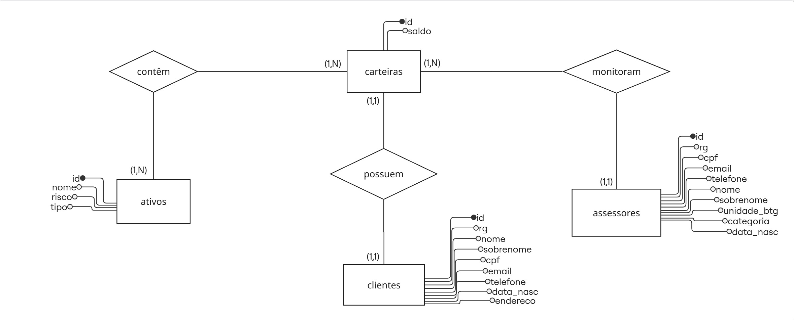<br>
<sup>Fonte: Material produzido pelos autores (2025) </sup>
</div>

&emsp; As entidades representam itens do mundo real, e foram selecionados os seguintes:

- **Clientes:** representam os usuários finais da plataforma, contendo informações cadastrais como nome, CPF e data de nascimento.

- **Assessores:** profissionais responsáveis por acompanhar e orientar os clientes por meio de suas carteiras.

- **Ativos:** produtos financeiros disponíveis para composição das carteiras dos clientes.

&emsp; Entre os relacionamentos e suas cardinalidades, ou seja, maneira de descrever em valores quantitativos estes relacionamentos, foram marcados por:

- **Clientes — Contêm — Ativos (N:N)**

  Um cliente pode conter um ou vários ativos ao mesmo tempo que cada ativo pode ser associado a varios clientes.
  
- **Assessores — Monitoram — Clientes (1:N)**

  Um assessor pode monitorar diversos clientes, e ao mesmo tempo cada cliente é acompanhado por um único assessor.

&emsp; O modelo conceitual existe para ser acessível a olhares diferentes do técnico. Dessa forma, é implicito neste o uso de tabelas intermediárias para relações N:N e entidades fracas, como as de log. Essas estarão representadas na seção [4.3](#43-modelo-lógico-de-dados) e [4.4](#44-modelo-físico-de-dados) — modelo físico e lógico de dados respectivamente.

## 4.3 Modelo Lógico de Dados

&emsp;Como apresentado por Elmasri et. al (2005), um Modelo Lógico-Relacional se assemelha ao Modelo Entidade Relacionamento quanto à composição dos principais agentes de um banco de dados que irão deter de características (atributos) e relacionamentos, embora se trate de um modelo de dados realístico em relação à tipagem, armazenamento, funcionamento e organização das informações.

&emsp;Tem-se o seguinte modelo elaborado para o presente projeto para o BTG Pactual, produzido através da plataforma de design de banco de dados [dbdiagram.io](https://dbdiagram.io/):

<div align="center">
<sub>Figura x - Modelo Lógico-Relacional</sub><br>
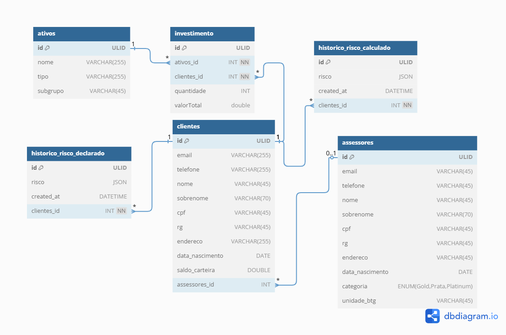<br>
<sup>Fonte: Material produzido pelos autores (2025) </sup>
</div>

<!--

Table clientes {
  id ULID [primary key]
  email VARCHAR(255)
  telefone VARCHAR(255)
  nome VARCHAR(45)
  sobrenome VARCHAR(70)
  cpf VARCHAR(45)
  rg VARCHAR(45)
  endereco VARCHAR(255)
  data_nascimento DATE
  saldo_carteira DOUBLE
  assessores_id INT
}

Table assessores {
  id ULID [primary key]
  email VARCHAR(45)
  telefone VARCHAR(45)
  nome VARCHAR(45)
  sobrenome VARCHAR(70)
  cpf VARCHAR(45)
  rg VARCHAR(45)
  endereco VARCHAR(45)
  data_nascimento DATE
  categoria ENUM('Gold', 'Prata', 'Platinum')
  unidade_btg VARCHAR(45)
}

Table ativos {
  id ULID [primary key]
  nome VARCHAR(255)
  tipo VARCHAR(255)
  subgrupo VARCHAR(45)
}

Table investimento {
  id ULID [primary key]  
  ativos_id INT [not null]
  clientes_id INT [not null]
  quantidade INT
  valorTotal double
}

Table historico_risco_declarado {
  id ULID [primary key]
  risco JSON
  created_at DATETIME
  clientes_id INT [not null]
}

Table historico_risco_calculado {
  id ULID [primary key]
  risco JSON
  created_at DATETIME
  clientes_id INT [not null]
}

// Relações

Ref: clientes.assessores_id > assessores.id
Ref: investimento.ativos_id > ativos.id
Ref: investimento.clientes_id > clientes.id
Ref: historico_risco_declarado.clientes_id > clientes.id
Ref: historico_risco_calculado.clientes_id > clientes.id


-->

&emsp;É importante ressaltar determinadas justificativas para alguns pontos relacionados ao modelo; a entidade clientes representa os investidores do sistema, sendo uma regra de negócio um cliente poder possuir apenas uma carteira de investimento no banco BTG Pactual, e por isso, a tabela também contempla informações financeiras como o `saldo_carteira`. Além disso, toda vez que o teste de perfil de risco, essa informação é registrada como histórico dentro da entidade historico_risco_declarado através do campo "risco" e o created_at que guarda o instante exato do registro. Um cliente pode estar associado apenas com o seu perfil de risco mais atual dentro o histórico, mas um tipo de perfil de risco pode estar atribuído a vários clientes, por isso o relacionamento de um-para-muitos; também há a associação com a entidade historico_risco_calculado, por onde se espera registrar o cálculo de perfil de risco a partir da leitura de ativos que compoem a carteira de investimento. Da mesma forma, o risco fica armazenado no campo "risco", obtendo-se um created_at que indica o instante exato do cálculo. A carteira do cliente pode estar associada com seu perfil de risco mais atual dentre o histórico, mas um tipo de perfil de risco pode estar atribuído à carteira de vários clientes, por isso o relacionamento de um-para-muitos.

&emsp;Ainda nesse contexto, vale ressaltar que anteriormente as informações financeiras de uma carteira eram mantidas em uma tabela separada, entretanto, para fins de facilidade de comunicação e acesso dos futuros serviços a serem implementados para no aplicativo, manteve-se as informações da carteira dentro da tabela de cliente. 

&emsp;Além disso, a decisão de se manter em tabelas separadas os registros de perfis de risco calculados e declarados se deu pela intenção de tanto manter um histórico detalhado dessas informações, quanto garantir uma maneira fácil de atribuir os resultados dos cálculos de perfis, ainda que sua lógica seja alterada conforme evolução da solução. Ademais, através dos campos `risco` como tipo JSON, é possível construir metadados flexíveis para maior detalhamento dessas atividades. 

&emsp;Outro detalhe é o tipo "enum" do campo `categoria` na tabela de assessores, que se trata de um enumerador que pode atribuir 3 características possíveis de categoria de um assessor — Ouro, Prata e Platinum —, baseada no nível patrimonial dos investidores que ele atende.

&emsp;Em resumo, o modelo foi construído para ser flexível e escalável, fornecendo rastreabilidade temporal e permitindo a expansão futura para auditoria, governança e recomendações automatizadas de alocação.

## 4.4 Modelo Físico de Dados
_conteúdo_

**Nota:** Insira uma explicação e direcionamento para o readme.md da pasta database.

# 5. Solução Técnica (Design)

## 5.1 Diagrama de Casos de Uso

### 5.1.1 Visão Geral do Sistema

&emsp;O sistema de gestão de investimentos tem como objetivo principal permitir que assessores de investimentos visualizem e entendam as alocações de investimentos de seus clientes, identifiquem desalinhamentos entre o perfil, assim, podendo sugerir readequações quando necessário.

### 5.1.2 Atores

- **Assessor de Investimento**: Usuário principal do sistema que utiliza as informações para analisar carteiras de clientes e sugerir readequações.

### 5.1.3 Casos de Uso

#### 5.1.3.1 Importar Dados de Carteira via API

**Descrição**: O sistema importa e processa automaticamente os dados de carteira de clientes por meio de integração via API.

**História de Usuário**:  
Como um assessor de investimento, quero que o sistema importe automaticamente os dados das carteiras dos clientes via API para que eu tenha informações atualizadas sem precisar inserir dados manualmente.

#### 5.1.3.2 Calcular Perfil de Risco

**Descrição**: O sistema calcula automaticamente o perfil de risco com base nos ativos da carteira.

**História de Usuário**:  
Como um assessor de investimento, quero que o sistema calcule automaticamente o perfil de risco com base nos ativos da carteira para que eu possa entender rapidamente o nível de exposição a risco de cada cliente.

**Relacionamentos**:
- **<<include>>** Importar Dados de Carteira via API

#### 5.1.3.3 Verificar Conformidade de Perfil
**Descrição**: O sistema verifica a conformidade entre o perfil calculado e o perfil cadastrado do cliente.

**História de Usuário**:  
&emsp;Como um assessor de investimento, quero que o sistema verifique a conformidade entre o perfil calculado e o perfil cadastrado do cliente para que eu possa identificar possíveis desalinhamentos.

**Relacionamentos**:
- **<<include>>** Calcular Perfil de Risco

#### 5.1.3.4 Exibir Recomendações de Readequação
**Descrição**: O sistema exibe recomendações de readequação do perfil quando for identificado um desalinhamento.

**História de Usuário**:  
&emsp;Como um assessor de investimento, quero visualizar recomendações de readequação quando um desalinhamento de perfil for identificado para que eu possa sugerir ajustes apropriados aos meus clientes.

**Relacionamentos**:
- **<<include>>** Verificar Conformidade de Perfil

#### 5.1.3.5 Visualizar Painel de Conformidade
**Descrição**: O sistema apresenta, de forma visual, o status de conformidade de todas as carteiras em um painel.

**História de Usuário**:  
&emsp;Como um assessor de investimento, quero visualizar em um painel o status de conformidade de todas as carteiras para que eu possa ter uma visão geral da situação dos meus clientes.

**Relacionamentos**:
- **<<include>>** Verificar Conformidade de Perfil

#### 5.1.3.6 Filtrar Carteiras por Status
**Descrição**: O sistema oferece filtros por status de conformidade (adequado/não adequado).

**História de Usuário**:  
&emsp;Como um assessor de investimento, quero filtrar as carteiras por status de conformidade (adequado/não adequado) para que eu possa priorizar os clientes que precisam de atenção imediata.

#### 5.1.3.7 Filtrar Clientes por Segmento
**Descrição**: O sistema permite filtro de clientes por segmento (Prata, Ouro, Platinum).

**História de Usuário**:  
&emsp;Como um assessor de investimento, quero filtrar os clientes por segmento (Prata, Ouro, Platinum) para que eu possa direcionar meus esforços de acordo com a importância do cliente.

#### 5.1.3.8 Consultar Histórico de Sugestões
**Descrição**: O sistema mantém o histórico das sugestões de readequação de perfil por cliente.

**História de Usuário**:  
&emsp;Como um assessor de investimento, quero consultar o histórico das sugestões de readequação de perfil por cliente para que eu possa acompanhar a evolução e as recomendações anteriores.

#### 5.1.3.9 Visualizar Composição da Carteira
**Descrição**: O sistema exibe graficamente a composição da carteira por tipo de ativo.

**História de Usuário**:  
&emsp;Como um assessor de investimento, quero visualizar graficamente a composição da carteira por tipo de ativo para que eu possa entender melhor a distribuição dos investimentos dos clientes.

### 5.1.4 Tabela de Associação entre Requisitos Funcionais e Casos de Uso

| ID | Requisito Funcional | Prioridade | Caso de Uso Associado |
|----|-------------------|------------|---------------------|
| RF01 | O sistema deve importar e processar automaticamente os dados de carteira de clientes por meio de integração via API. | Alta | Importar Dados de Carteira via API |
| RF02 | O sistema deve calcular automaticamente o perfil de risco com base nos ativos da carteira. | Alta | Calcular Perfil de Risco |
| RF03 | O sistema deve verificar a conformidade entre o perfil calculado e o perfil cadastrado do cliente. | Alta | Verificar Conformidade de Perfil |
| RF04 | O sistema deve exibir recomendações de readequação do perfil quando for identificado um desalinhamento. | Alta | Exibir Recomendações de Readequação |
| RF05 | O sistema deve apresentar, de forma visual, o status de conformidade de todas as carteiras em um painel. | Alta | Visualizar Painel de Conformidade |
| RF06 | O sistema deve oferecer filtros por status de conformidade (adequado/não adequado). | Média | Filtrar Carteiras por Status |
| RF07 | O sistema deve permitir filtro de clientes por segmento (Prata, Ouro, Platinum). | Média | Filtrar Clientes por Segmento |
| RF08 | O sistema deve manter o histórico das sugestões de readequação de perfil por cliente. | Média | Consultar Histórico de Sugestões |
| RF09 | O sistema deve exibir graficamente a composição da carteira por tipo de ativo. | Baixa | Visualizar Composição da Carteira |

<div align="center">
<sub>Figura x - Diagrama de Casos de Uso</sub><br>
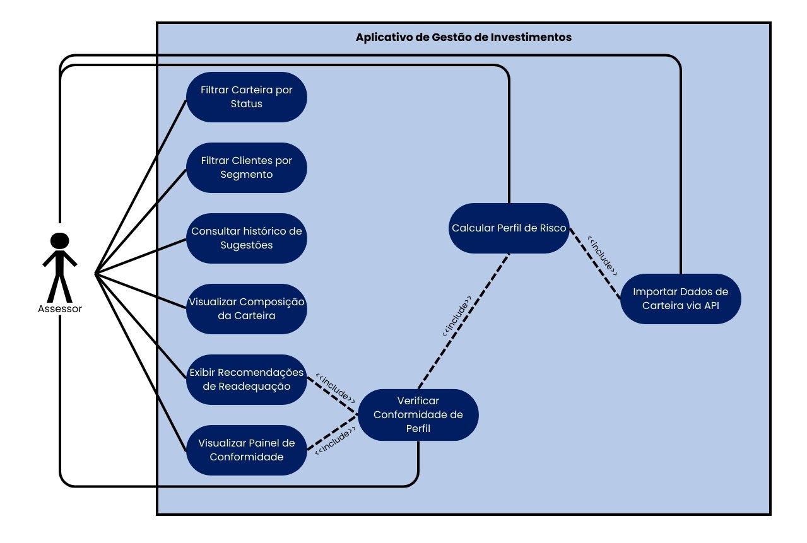<br>
<sup>Fonte: Material produzido pelos autores (2025) </sup>
</div>

## 5.2 Diagrama de Classes

### Visão Geral do Diagrama de Classes

&emsp;O diagrama de classes representa o modelo de domínio do sistema, identificando as principais entidades, seus atributos, métodos e relacionamentos. Ele foi desenvolvido com base na estrutura lógica do banco de dados e nos requisitos do sistema de recomendação de investimentos.

As principais classes são:

- `Cliente` – representa o investidor, incorporando também os atributos da carteira
- `Assessor` – profissional responsável por acompanhar o cliente e aprovar perfis
- `Investimento` – vincula o cliente a um ativo, registrando o histórico de aplicações
- `Ativo` – produto financeiro disponível para investimento
- `HistoricoRiscoDeclarado` – representa os perfis de risco informados pelo cliente
- `HistoricoRiscoCalculado` – representa os perfis de risco gerados automaticamente
- `Recomendacao` – representa sugestões de investimento geradas pelo sistema para o cliente

<br>
<div align="center">
<sub>Figura x - Diagrama de Classes</sub>
<br>
<br>
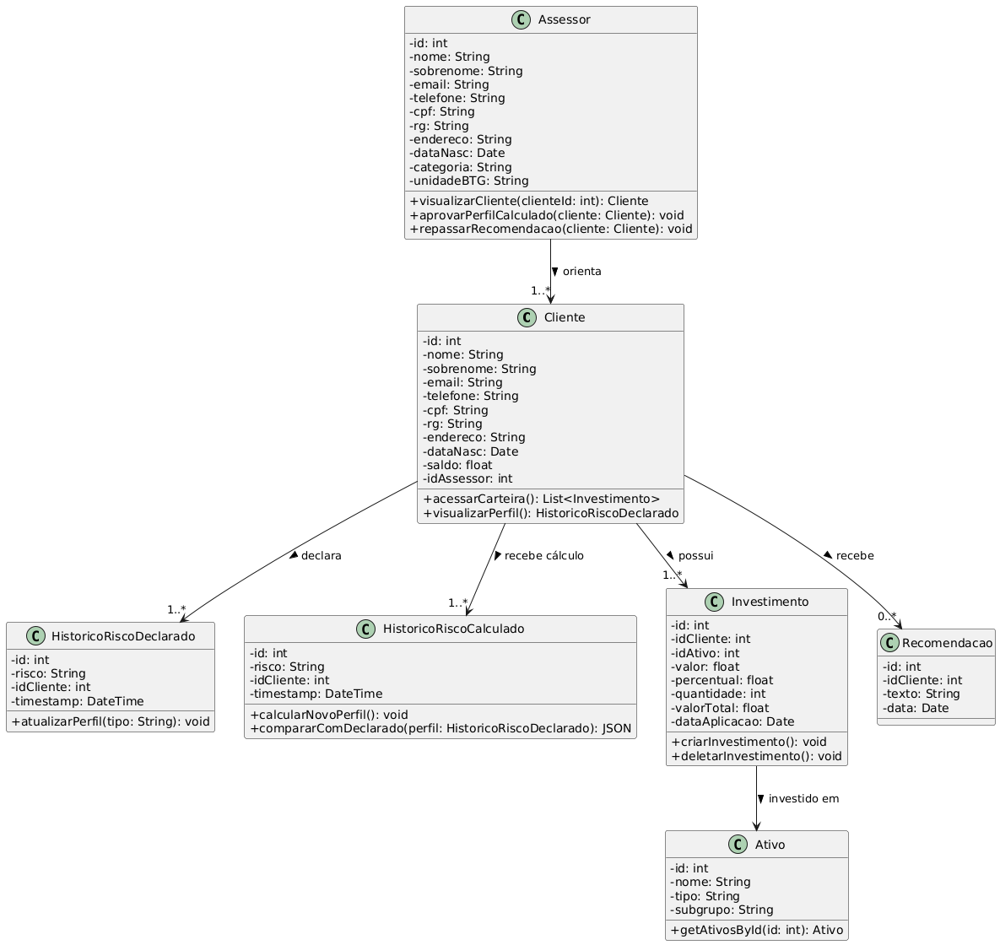
<br>
<br>
<sup>Fonte: Material produzido pelos autores (2025)</sup>
</div>
<br>

## Descrição das Classes

### Classe `Cliente`

&emsp;Representa um investidor do sistema. Anteriormente separada da `Carteira`, agora incorpora também os atributos da carteira e se relaciona diretamente com o `Assessor`.

| Atributo     | Tipo    | Descrição                        |
|--------------|---------|----------------------------------|
| id           | UUID    | Identificador único              |
| nome         | String  | Primeiro nome do cliente         |
| sobrenome    | String  | Sobrenome do cliente             |
| email        | String  | Contato por e-mail               |
| telefone     | String  | Contato por telefone             |
| cpf          | String  | CPF do cliente                   |
| rg           | String  | Documento de identidade          |
| endereco     | String  | Endereço residencial             |
| dataNasc     | Date    | Data de nascimento               |
| saldo        | float   | Valor total investido            |
| assessor     | Assessor| Assessor responsável             |

**Métodos:**

- `acessarCarteira()`: retorna a lista de investimentos do cliente
- `visualizarPerfil()`: retorna o perfil declarado associado


### Classe `Assessor`

Responsável por acompanhar clientes e aprovar perfis de risco calculados.

| Atributo     | Tipo               | Descrição                        |
|--------------|--------------------|----------------------------------|
| id           | UUID               | Identificador único              |
| nome         | String             | Primeiro nome                    |
| sobrenome    | String             | Sobrenome                        |
| email        | String             | Contato                          |
| telefone     | String             | Contato                          |
| cpf          | String             | CPF                              |
| rg           | String             | Documento de identidade          |
| endereco     | String             | Endereço                         |
| dataNasc     | Date               | Data de nascimento               |
| categoria    | CategoriaAssessor  | Categoria do assessor (enum)     |
| unidadeBTG   | String             | Local de atuação                 |

**Métodos:**

- `visualizarCliente(clienteId)`: acessa os dados de um cliente
- `aprovarPerfilCalculado(cliente)`: valida o perfil calculado do cliente
- `repassarRecomendacao(cliente)`: repassa a recomendação gerada pelo sistema


### Classe `Investimento`

Representa uma aplicação específica feita por um cliente em um ativo.

| Atributo       | Tipo     | Descrição                                 |
|----------------|----------|-------------------------------------------|
| id             | UUID     | Identificador do investimento             |
| cliente        | Cliente  | Cliente que realizou o investimento       |
| ativo          | Ativo    | Ativo investido                           |
| valor          | float    | Valor aplicado                            |
| percentual     | float    | Participação percentual na carteira       |
| quantidade     | int      | Quantidade de ativos comprados            |
| valorTotal     | float    | Valor total da posição (quantidade × preço) |
| dataAplicacao  | Date     | Data da aplicação                         |

**Métodos:**

- `criarInvestimento()`: registra um novo investimento
- `deletarInvestimento()`: remove um investimento existente


### Classe `Ativo`

Representa um produto financeiro (fundo, ação, título, etc.) disponível no sistema.

| Atributo   | Tipo    | Descrição                                 |
|------------|---------|---------------------------------------------|
| id         | UUID    | Identificador único do ativo               |
| nome       | String  | Nome do ativo                              |
| tipo       | String  | Tipo de ativo (ex: fundo, ação, renda fixa)|
| subgrupo   | String  | Categoria mais específica do ativo         |

**Método:**

- `getAtivosById(id)`: retorna os dados do ativo com base no ID informado


### Classe `HistoricoRiscoDeclarado`

Representa o perfil de risco informado pelo cliente.

| Atributo    | Tipo      | Descrição                            |
|-------------|-----------|----------------------------------------|
| id          | UUID      | Identificador                         |
| risco       | JSON      | Perfil de risco declarado             |
| cliente     | Cliente   | Cliente que declarou                  |
| timestamp   | DateTime  | Data da declaração                    |

**Método:**

- `atualizarPerfil(tipo)`: atualiza o tipo de perfil declarado


### Classe `HistoricoRiscoCalculado`

&emsp;Representa o resultado calculado automaticamente do perfil de risco do cliente com base nos seus ativos.

| Atributo    | Tipo      | Descrição                            |
|-------------|-----------|----------------------------------------|
| id          | UUID      | Identificador                         |
| risco       | String    | Perfil calculado                      |
| cliente     | Cliente   | Cliente analisado                     |
| timestamp   | DateTime  | Data do cálculo                       |

**Métodos:**

- `calcularNovoPerfil()`: calcula o perfil com base nos ativos
- `compararComDeclarado(perfil)`: retorna um JSON com a análise comparativa


### Classe `Recomendacao`

&emsp;Classe que representa uma recomendação de alocação ou ação gerada automaticamente pelo sistema para o cliente.

| Atributo    | Tipo    | Descrição                                 |
|-------------|---------|--------------------------------------------|
| id          | UUID    | Identificador da recomendação             |
| cliente     | Cliente | Cliente ao qual a recomendação se destina |
| texto       | String  | Conteúdo da recomendação                  |
| data        | Date    | Data de geração da recomendação           |


### Enum `CategoriaAssessor`

Define os níveis de assessores possíveis no sistema:

- `Gold`
- `Prata`
- `Platinum`


### Relacionamentos

| Origem               | Destino                  | Tipo de Relação | Descrição                                               |
|----------------------|--------------------------|------------------|-----------------------------------------------------------|
| Cliente              | Investimento             | 1:N              | Um cliente pode possuir vários investimentos             |
| Investimento         | Ativo                    | N:1              | Cada investimento se refere a um único ativo             |
| Cliente              | HistoricoRiscoDeclarado  | 1:N              | Um cliente pode declarar múltiplos perfis ao longo do tempo |
| Cliente              | HistoricoRiscoCalculado  | 1:N              | Um cliente pode ter múltiplos perfis calculados          |
| Cliente              | Recomendacao             | 0:N              | Um cliente pode receber várias recomendações             |
| Assessor             | Cliente                  | 1:N              | Um assessor orienta vários clientes                      |


### Conclusão

&emsp;O diagrama de classes apresentado estrutura de forma clara os elementos centrais do sistema de recomendação de investimentos, alinhando-se à lógica de domínio da aplicação e às entidades presentes no banco de dados. A modelagem contempla os dados dos clientes, assessores, investimentos e perfis de risco, permitindo a geração automatizada de recomendações e sua posterior validação.

&emsp;Além disso, os relacionamentos entre as classes refletem corretamente a multiplicidade e o fluxo de responsabilidade entre os agentes do sistema, proporcionando uma base sólida para o desenvolvimento e validação das funcionalidades previstas.

&emsp;Esse diagrama fornece uma base conceitual robusta para o desenvolvimento do sistema, servindo como referência para a implementação de funcionalidades, a definição das regras de negócio e a integração entre os módulos do projeto.


## 5.3 Diagrama de Componentes da UML

  &emsp;O diagrama de componentes da UML é utilizado para representar a estrutura modular de um sistema, evidenciando como seus diferentes blocos de software se organizam e se comunicam. Nesta seção, está apresentado o diagrama que descreve a arquitetura do aplicativo mobile da plataforma de recomendação, destacando os principais componentes envolvidos — desde a interface com o usuário até os serviços de backend, autenticação e armazenamento de dados.

<div align="center">
<sup>Figura X - Diagrama de Componentes do App Mobile BTG</sup>  
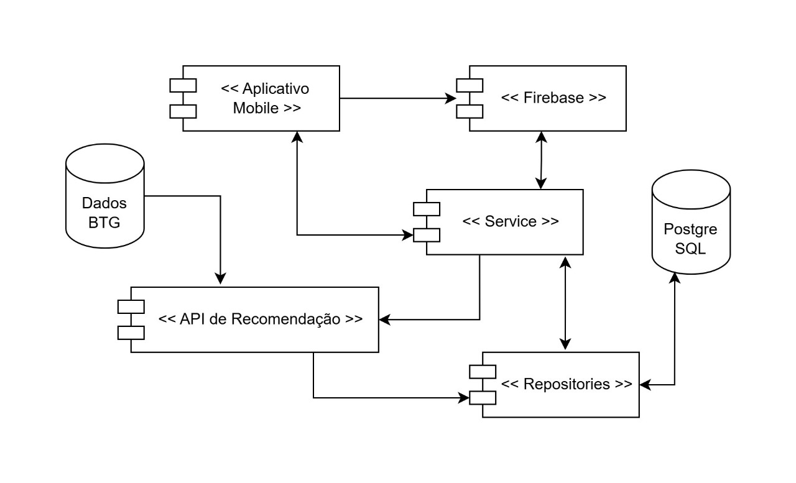  
<sub>Fonte: Material produzido pelos autores (2025)</sub>  
</div>

## Arquitetura em Camadas do Aplicativo

O sistema segue uma arquitetura em camadas, organizada em: **Camada de Apresentação**, **Camada de Negócio** e **Camada de Dados**, fragmentadas nos componentes conforme o diagrama. Abaixo descrevemos os blocos responsáveis por cada funcionalidade:

### Camada de Apresentação (Frontend Mobile)

A interface principal para os assessores do BTG é o **Aplicativo Mobile**, responsável por coletar dados do usuário, exibir informações de perfil, recomendações e alertas de conformidade.

#### Componentes:
- **Aplicativo Mobile (React Native):** Permite a interação do usuário com o sistema.
- **Firebase:** Suporte a autenticação, notificações e sincronização em tempo real com o app.

#### Fluxo:
1. O usuário acessa o sistema pelo aplicativo mobile.
2. O app se comunica com o **Firebase** para autenticação e sincronização.
3. Requisições relacionadas a dados e recomendações são enviadas ao módulo **Service**, que coordena a lógica de negócio.

---

### Camada de Negócio (Backend / Orquestração)

Responsável por orquestrar o processamento, validações e geração de recomendações com base nas informações fornecidas pelos usuários e dados do BTG.

#### Componentes:
- **Service:** Intermediário entre o app, o Firebase e os módulos internos do backend. Gerencia lógica de fluxo e chamadas de API.
- **API de Recomendação:** Executa as regras de negócio, reclassificação de perfis e sugestão de alocação conforme regulamentação da CVM.
- **Repositories:** Responsável por interagir com o banco de dados relacional para consultas e atualizações.

#### Fluxo:
1. O **Service** recebe requisições do app, autentica via Firebase e direciona as chamadas para a **API de Recomendação**.
2. A API de Recomendação processa os dados recebidos e envia instruções de leitura/escrita para os **Repositories**.
3. Os **Repositories** acessam o banco **PostgreSQL** para persistência ou leitura das informações.

---

### Camada de Dados

Abriga os dados estruturados e operacionais do sistema.

#### Componentes:
- **PostgreSQL:** Banco relacional para armazenamento de perfis de investidores, carteiras, registros de recomendação e histórico.
- **Dados BTG:** Fonte externa integrada ao sistema que fornece informações essenciais para análise e recomendação.

#### Fluxo:
1. A **API de Recomendação** consome os **Dados BTG** para análise inicial.
2. **Repositories** acessam o **PostgreSQL** para registrar, atualizar ou recuperar dados do sistema.
3. Resultados são retornados à **Camada de Negócio** e exibidos ao usuário via o app mobile.


## 5.4 Diagramas de Sequência da UML

&emsp; Este fluxo descreve o processo de autenticação e análise de perfis com inconsistências no sistema, incluindo o uso de filtros para refinar a consulta. O sistema é acessado por um assessor via aplicativo mobile, e os dados são processados por um serviço de backend que utiliza um banco PostgreSQL.

<div align="center">
<sub>Figura x - Diagrama de Filtro UML</sub><br>
<br>
<sup>Fonte: Material produzido pelos autores (2025) </sup>
</div>

### Ator
- **Assessor**: Usuário que utiliza o aplicativo para consultar perfis com inconsistências.

### Componentes
- App Mobile (React Native): Interface de entrada usada pelo assessor.
- API Gateway(.NET): Intermediador de requisições.
- Firebase: Serviço de autenticação.
- Serviço de Análise: Responsável por processar e consultar dados relacionados às divergências.
- PostgreSQL: Banco de dados que armazena os perfis dos usuários.
- Usuário: Representa os dados dos perfis armazenados.

### Fluxo de Login
1. O assessor abre o aplicativo.
2. Insere e envia as credenciais.
3. A API Gateway valida as credenciais com o Firebase.

#### Credencias válidas:
- Firebase retorna um token de acesso.
- API solicita o acesso à aba de análise (com o token).
- A requisição com token é enviada ao Serviço de Análise.
- O serviço consulta os perfis com inconsistências no banco PostgreSQL.
- Os dados processados retornam à API, que envia a lista de perfis ao app.
- O aplicativo exibe os perfis filtrados.

#### Credenciais inválidas: 
- API recebe erro de autenticação.
- O app exibe mensagem de erro.

### Interação com Filtro
1. O assessor clica em "Filtrar por divergência".
2. O app envia a requisição de perfis divergentes com filtro para a API.
3. A API reenviará a solicitação ao Serviço de Análise, agora com os filtros aplicados.
4. O serviço consulta novamente o banco de dados com os filtros.

#### Perfis encontrados: 
- Serviço retorna perfis com divergência.
- App exibe a lista.

#### Nenhum perfil encontrado:
- Serviço retorna resposta vazia.
- App exibe mensagem: "Nenhum perfil encontrado".

&emsp;Este fluxo garante que apenas usuários autenticados tenham acesso aos dados analisados, promovendo segurança e precisão na identificação de perfis com inconsistências.

## 5.5 Tecnologias e Linguagens

### 5.5.1 Back-end

&emsp;Para o back-end da aplicação, será utilizada a linguagem de programação **C#**, em conjunto com o framework **.NET**. Essa escolha se deve à robustez, segurança e excelente desempenho do .NET, além de sua forte integração com bibliotecas de machine learning através do **ML.NET**, permitindo a incorporação de modelos treinados diretamente no ambiente do servidor.

### 5.5.2 Machine Learning e Tratamento de Dados

&emsp;Para o tratamento de dados e preparação de modelos de aprendizado de máquina, será utilizada a linguagem **Python**. Python é amplamente adotada na área de ciência de dados devido à sua simplicidade, vasta gama de bibliotecas (como Pandas, NumPy, e Scikit-learn) e grande comunidade. O processo de retreinamento dos modelos será gerenciado com o auxílio do **MLflow**, que permite o controle de versões, monitoramento de experimentos e gerenciamento de modelos de forma eficiente.

### 5.5.3 Front-end

&emsp;O front-end da aplicação será desenvolvido com **React Native**, uma tecnologia que permite a criação de aplicações móveis multiplataforma com desempenho próximo ao nativo. Apesar de o projeto estar sendo desenvolvido inicialmente para Android, a escolha pelo React Native se dá justamente por sua natureza multiplataforma, o que facilitará a adaptação futura para outros sistemas operacionais, como o iOS, além de proporcionar uma interface moderna, responsiva e de fácil manutenção.

### 5.5.4 Banco de Dados

&emsp;O sistema utilizará o **PostgreSQL** como sistema gerenciador de banco de dados relacional. O PostgreSQL foi escolhido por ser uma solução open-source poderosa, altamente escalável, que oferece suporte a consultas complexas, integridade referencial e extensões úteis para aplicações que trabalham com dados estruturados de forma intensiva.

### 5.5.5 Autenticação

&emsp;Para o gerenciamento da autenticação de usuários, será utilizado o Firebase Authentication. O Firebase oferece uma solução segura, escalável e de fácil integração com aplicações móveis, reduzindo significativamente o esforço de desenvolvimento e aumentando a segurança da aplicação. Além disso, a plataforma disponibiliza uma cota gratuita com capacidade de armazenamento razoavelmente grande, o que contribui para tornar o desenvolvimento menos custoso, especialmente nas fases iniciais do projeto.
<br><br>


# 6. Mapeamento Técnico de Infraestrutura e Implantação
_conteúdo_

## 6.1 Diagrama de Implantação da UML
_conteúdo_

## 6.2 Justificativa das Escolhas de Implantação
_conteúdo_

## 6.3 Considerações sobre Desempenho e Segurança
_conteúdo_

# 7. Projeto Visual da Solução

Antes da implementação de qualquer solução digital, é fundamental estruturar visualmente as funcionalidades e a experiência do usuário. Por isso, o desenvolvimento do **wireframe** e do **mockup** representa uma etapa estratégica no processo de design de interfaces.

O **wireframe** atua como o esqueleto do aplicativo, permitindo mapear e testar a **estrutura, hierarquia da informação e fluxos de navegação**, sem distrações com elementos visuais. No nosso caso, o foco *Mobile First* orientou todas as decisões para garantir usabilidade, clareza e agilidade na experiência do assessor em dispositivos móveis — onde o espaço é limitado e a interação depende de toques e gestos.

Já o **mockup** transforma essa estrutura bruta em uma representação visual mais refinada e próxima do produto final. Ele incorpora **cores, ícones, fontes, espaçamentos e feedbacks visuais**, além de simular interações e transições, ajudando a validar a estética e a identidade visual com todos os stakeholders do projeto.

Essa jornada do wireframe ao mockup possibilita:
- Detectar e corrigir problemas de usabilidade antes da codificação;
- Alinhar expectativas com o parceiro (BTG Pactual);
- Comunicar com clareza a proposta da solução para desenvolvedores, designers e usuários finais.


O projeto visual da solução foi desenvolvido com foco na abordagem *Mobile First*, garantindo acessibilidade e usabilidade otimizadas para dispositivos móveis. O aplicativo tem como objetivo auxiliar assessores do BTG Pactual na verificação da conformidade entre o perfil de investidor e a alocação de ativos dos clientes, conforme a Resolução CVM 175.

---

## 7.1 Desenvolvimento de Wireframes

Os wireframes foram elaborados no Figma utilizando boas práticas de design responsivo, como:

- **Auto Layout**, **Componentes reutilizáveis** e **Propriedades** para escalabilidade.
- **Espaçamentos múltiplos de 4px** e **grid de 8 colunas com 8px de *gutter*** para organização visual.
- Pensamento **Mobile First**, priorizando a navegação fluida e rápida para o assessor.
- Sumário identificando os componentes principais de cada tela, conforme o anexo.

### Justificativa das Escolhas de Design

- **Login/Cadastro**: Organização simples e direta, com foco em agilidade no acesso.
- **Página Home**: Exibe dados principais em destaque (carteiras conformes e não conformes) com **navegação rápida por categoria**, minimizando toques.
- **Menus** e **botões** otimizados para uso com o polegar e legibilidade em telas pequenas.
- **Cards informativos** com dados essenciais visíveis antes do clique, antecipando ações do usuário.
- **Gestos e transições** foram considerados para navegação entre as telas, como `swipe` lateral para voltar.

### Técnicas Mobile Avançadas

- Utilização de **microinterações** visuais nas ações de navegação e feedbacks (simulados via *prototype*).
- Design baseado em **tamanho de toque ideal** (mínimo 48x48px).
- Layout adaptável para diferentes resoluções, mantendo consistência entre dispositivos.

### Visualização

<div align="center">
<sub>Figura 1 - Wireframe</sub><br> 
<br> 
<sup>Fonte: Material produzido pelos autores (2025) </sup>
</div>

[🔗 Para uma melhor visualização, acesse o mockup navegável no Figma](https://www.figma.com/design/RK6GBR1YMOYdaURL9BT2EA/Wireframe-Luan-Melancia?node-id=0-1&t=ZYm11fcshftQCr0X-1)

---

## 7.2 Desenvolvimento de Mockups

Os mockups foram desenvolvidos com base no wireframe aprovado, refletindo a identidade visual do parceiro BTG Pactual. Utilizamos:

- **Cores institucionais**:  
  - Azul escuro `#001E62` (primária);  
  - Azul claro `#AEC3F5` (secundária);  
  - Azul muito claro `#C2D5FF` (background);  
  - Vermelho rosado `#FF7CA1` (destaques, em alusão ao nome do grupo: *Watermelon*).

- **Ícones Phosphor (peso regular)**: Uniformes e leves, garantindo consistência visual.
- Tipografia legível e hierarquia clara de informações.
- Proporções respeitadas segundo os grids e espaçamentos definidos no wireframe.

### Navegabilidade

O mockup possui fluxo interativo completo com transições suaves e simulação realista da navegação no app, permitindo que o usuário explore:

- Login, cadastro e recuperação de senha;
- Home com KPIs principais;
- Visualização por categoria de perfil de investidor;
- Detalhamento das carteiras e dos clientes;
- Perfil do assessor.

### Consistência com o Wireframe

Todos os elementos de estrutura e navegação definidos nos wireframes foram mantidos. A navegação é fluida e intuitiva, com feedback visual em todas as ações simuladas.

### Visualização

<div align="center">
<sub>Figura 2 - Mockup</sub><br> 
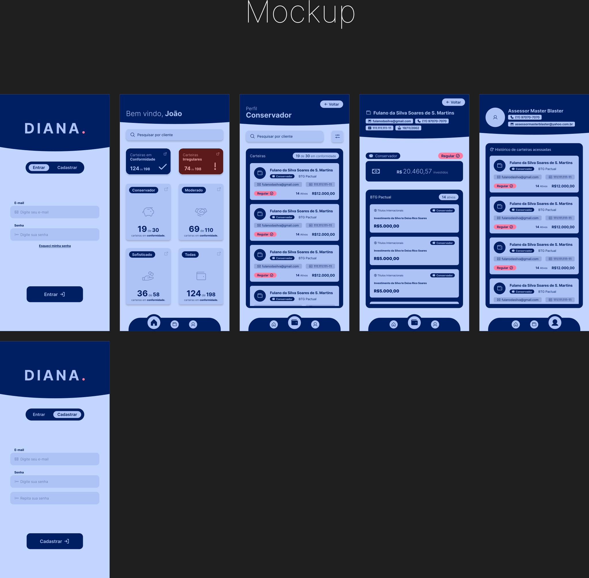<br> 
<sup>Fonte: Material produzido pelos autores (2025) </sup>
</div>

[🔗 Para uma melhor visualização, acesse o mockup navegável no Figma](https://www.figma.com/design/RK6GBR1YMOYdaURL9BT2EA/Wireframe-Luan-Melancia?node-id=1-50&t=ZYm11fcshftQCr0X-1)

---

## 7.3 Guia Visual

#
O Guia Visual foi elaborado de forma colaborativa durante o processo de desenvolvimento dos mockups. A intenção foi garantir **consistência visual, identidade clara e fácil manutenção do design** ao longo das iterações.

Nosso ponto de partida foi a paleta de cores institucional do parceiro BTG Pactual, o que nos permitiu alinhar o aplicativo à identidade da marca. Com isso, definimos um esquema de cores que equilibra seriedade e leveza visual. Adicionamos também uma cor de destaque — o vermelho rosado — como uma homenagem à identidade do nosso grupo "Watermelon", trazendo um toque único ao layout.

Além disso, definimos um sistema de componentes reutilizáveis no Figma, adotando padrões como:
- **Espaçamento múltiplo de 4px** e **grid de 8 colunas**;
- **Ícones com peso regular do Phosphor Icons**, garantindo harmonia visual;
- Tipografia clara e responsiva, assegurando legibilidade em telas pequenas.

Esse guia foi fundamental para manter a uniformidade e a eficiência ao longo do projeto, facilitando tanto o design quanto a futura implementação técnica.


### Paleta de Cores

| Cor               | Código Hex   | Aplicação                         |
|------------------|--------------|-----------------------------------|
| Azul escuro      | `#001E62`    | Cor primária (destaques, header) |
| Azul claro       | `#AEC3F5`    | Secundária (botões, cards)       |
| Azul muito claro | `#C2D5FF`    | Fundo geral                      |
| Vermelho rosado  | `#FF7CA1`    | Destaques e homenagens visuais   |

### Tipografia e Ícones

- Fonte: Inter (padrão do Figma)
- Tamanho mínimo de fonte: 14px
- Ícones: Phosphor Icons – Regular


<div align="center">
<sub>Figura X - Guia Visual</sub><br> 
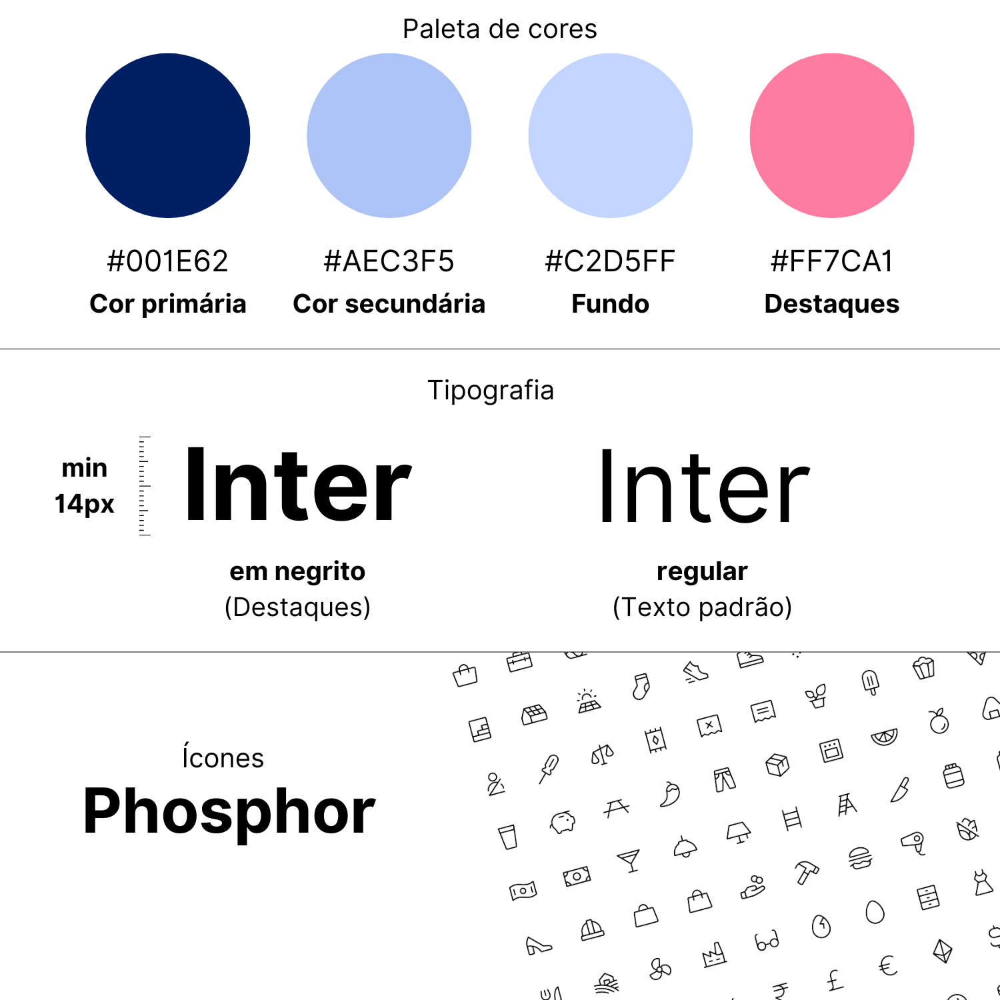<br> 
<sup>Fonte: Material produzido pelos autores (2025) </sup>
</div>

### Componentes Reutilizáveis

- **Card de Cliente**: Com foto, nome, perfil, conformidade, banco, CPF e e-mail.
- **Bloco de Ativos**: Listagem detalhada com tipo de ativo, valor e classificação.
- **Componentes de Navegação**: Menu inferior e botões principais otimizados para polegar.


# 8. Desenvolvimento do Projeto
_conteúdo_

## 8.1 Arquitetura de Codificação e Estrutura de Diretórios
_conteúdo_

## 8.2 Modelo de Recomendação
_conteúdo_

## 8.3 Desenvolvimento de Features
_conteúdo_

**Nota:** Insira uma explicação de entregas em cada Sprint.

## 8.3.1 Sprint 3

&emsp;Durante a Sprint 3, foi realizado o desenvolvimento de telas funcionais e componentes visuais reutilizáveis, utilizando **React Native** com estilização baseada em classes utilitárias do **NativeWind**, dentro do ambiente **Expo**. Os dados estão atualmente mockados, mas toda a lógica de estado (`useState`) e efeitos (`useEffect`) foi estruturada para permitir integração fluida com o backend nas próximas sprints.

---

## 🛠️ Tecnologias e Bibliotecas Utilizadas
- **React Native com Expo**: para desenvolvimento mobile multiplataforma.
- **NativeWind**: integração do estilo utilitário do Tailwind para React Native.
- **Phosphor Icons**: biblioteca de ícones leve e versátil.
- **Hooks (`useState`, `useEffect`)**: para controle de estado e ciclos de vida nas telas.

---

## Padrão Visual e Design System

&emsp;Toda a interface foi construída respeitando o design system definido no Figma, com cores customizadas aplicadas via `tailwind.config.ts`. As principais cores utilizadas foram:

```js
"azul-escuro-principal": "#001E62",
"azul-claro-principal": "#AEC3F5",
"azul-claro-secundario": "#C2D5FF",
"rosa-secundario": "#FF7CA1",
"vermelho-secundario": "#E9A5A5",
"vermelho-principal": "#5A1A1A"
```

&emsp;Também foram aplicadas sombras customizadas (`shadow-clicaveis`) para destacar componentes interativos e bordas arredondadas (`rounded-2xl`) para promover suavidade visual e acessibilidade.

---

## Componentes Desenvolvidos

<div align="center">
<sub>Figura X - Componentes</sub><br> 
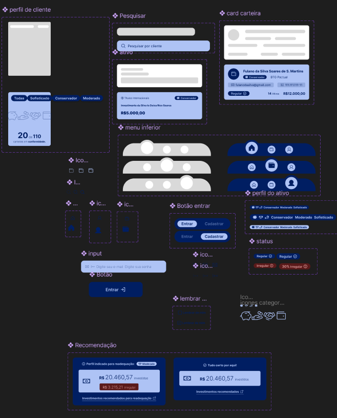<br> 
<sup>Fonte: Material produzido pelos autores (2025) </sup>
</div>

&emsp;Todos os componentes foram projetados com foco em **modularidade, reuso e clareza visual**, e seguem as boas práticas de composição de interfaces.

- **Componente de alternância (Switch)**: permite ao usuário alternar entre a tela de login e cadastro de forma intuitiva.
- **Inputs personalizados**: campos estilizados para e-mail, senha e dados cadastrais, com foco em usabilidade.
- **Botões de ação**: utilizados nas telas de login e cadastro, adaptáveis por props para diferentes ações.
- **Card de Quantitativo Geral**: exibe total de carteiras regulares ou irregulares. Sua aparência (cor, ícone e textos) se ajusta conforme o tipo.
- **Card por Perfil de Risco**: dinâmico, identifica o perfil de risco (Conservador, Moderado, Sofisticado) e exibe dados correspondentes com ícones e cores adequadas.
- **Componente de Pesquisa por Cliente**: input com placeholder contextual, reutilizável em diferentes telas.
- **Filtro de carteiras**: botão com função de abrir modal para aplicação de filtros por tipo de carteira.
- **Card de Carteira de Investimento**: mostra banco, CPF, valor total, status e outros dados relevantes de uma carteira.
- **Card de Ativo**: exibe os ativos individuais de uma carteira, com valor e nome.
- **Componente de Recomendação**: sugere investimentos alternativos com base na regularidade da carteira versus perfil de risco.
- **Menu Inferior (Bottom Navigation)**: fixo e funcional, com rotas para Home, Carteiras e Perfil.
- **Histórico de carteiras acessadas**: presente na tela de perfil do assessor, apresenta navegação por carteiras previamente consultadas.

---

## Telas Desenvolvidas

&emsp;As telas desenvolvidas seguiram exatamente o previsto no Mockup construído no Figma, com mínimas alterações para refletir os feedbacks coletados durante as Sprint Reviews.

### 1. Tela de Login/Cadastro  
&emsp;Alternância via switch entre os fluxos de autenticação. Campos de entrada e botões estilizados com feedback visual.

### 2. Tela Home  
Exibe:
- Mensagem de boas-vindas com nome do assessor.
- Campo de busca por cliente.
- Cards de resumo da quantidade de carteiras regulares/irregulares.
- Cards por perfil de risco.
- Menu inferior para navegação.

### 3. Tela de Carteiras por Perfil  
A partir do clique em um dos cards da Home, exibe:
- Campo de busca e botão de filtro.
- Quantidade de carteiras em conformidade no respectivo perfil.
- Cards de carteiras com informações resumidas.
OBS: em relação ao Mockup anterior, tags "Regular" e "Irregular" foram alteradas para a cor vermelho ou azul escuro.

### 4. Tela de Carteira Individual  
Mostra dados detalhados da carteira selecionada:
- Cabeçalho com informações do cliente.
- Situação de regularidade.
- Cards com ativos.
- Hiperlink para recomendações de readequação (em caso de irregularidade) ou mais investimentos (em caso de regularidade).
OBS: em relação ao Mockup anterior, tags "Regular" e "Irregular" foram alteradas para a cor vermelho ou azul escuro.

### 5. Tela de Perfil do Assessor  
Apresenta:
- Dados cadastrais do assessor.
- Container com histórico de carteiras acessadas.

## 8.3.2 Sprint 4
_conteúdo_

## 8.3.3 Sprint 5
_conteúdo_

## 8.4 Testes Unitários e de Integração

### Planejamento de testes unitários

&emsp;O desenvolvimento do aplicativo pretende seguir TDD (Test-Driven-Development), garantindo a qualidade, confiabilidade e evolução segura do sistema por meio de testes unitários. Dessa forma, essa seção detalha as estratégias para a construção de testes unitários que orientarão o desenvolvimento do aplicativo para o BTG Pactual. 

---

#### Procedimento esperado para o desenvolvimento

- **Para cada nova funcionalidade:**
1. Escreve-se primeiro um teste unitário que representa o comportamento esperado.
2. Implementa-se o código mínimo necessário para fazer o teste passar.
3. Refatora-se o código garantindo que os testes permaneçam passando.

---

#### Estratégias para Testes no Backend

**Ferramentas Utilizadas**
- `xUnit` – Framework de teste unitário.
- `Moq` – Mock de dependências (serviços, repositórios, VHS, API externa).

**Cobertura de Testes**
- **Controladores:** Validação de status codes e chamadas aos serviços.
- **Serviços:** Regras de negócio, integração com cache VHS, manipulação de dados.
- **Utilitários:** Funções auxiliares de formatação, cálculo, etc.
- **VHS (Cache):** Verificação se o dado está sendo buscado, armazenado e invalidado corretamente.

**Exemplo de Estrutura**
- Testes seguem a estrutura AAA (Arrange, Act, Assert).
- Cada método público deve ter ao menos 1 cenário positivo e 1 negativo testado.

---

#### Estratégias para Testes no Frontend

**Ferramentas Utilizadas**
- `Jest` – Teste de funções, hooks e lógicas internas.
- `React Native Testing Library (RNTL)` – Testes de componentes e interações.

**Cobertura de Testes**
- **Componentes Visuais:** Renderização com diferentes props e estados.
- **Hooks Customizados:** Validação de lógica reativa (ex: uso de contexto, chamadas de API).
- **Funções Isoladas:** Manipulação de dados, máscaras, validações de formulário.

**Boas Práticas**
- Testar estados iniciais, interações (ex: cliques, inputs), e efeitos visuais esperados.
- Usar mocks de APIs quando necessário.

---

#### Validação dos Resultados

- Os testes devem rodar automaticamente no pipeline CI/CD.
- Ferramentas de cobertura como `Coverlet` (.NET) e `Jest --coverage` devem ser usadas para acompanhar a cobertura mínima (recomenda-se 80%).

### Planejamento de testes de integração

&emsp;Esta subseção planeja os testes para a integração entre os módulos internos do sistema (como o .NET para o back-end React Native integrado ao Expo no front-end), assim como entre o backend e as APIs externas, utilizando caching (VHS). Os testes pretendem verificar tanto o comportamento esperado quanto a resposta a erros, validando possíveis interações críticas.

---

#### Pontos de Integração Identificados

- **Frontend (React Native/Expo) → Backend (.NET API)**
- **Backend → Camadas Internas (controladores, serviços, repositórios)**
- **Backend → Cache (VHS)**
- **Backend → Banco de Dados**
- **Backend → API Externa (com cache VHS obrigatoriamente)**

---

#### Integração: Frontend ↔ Backend

- **Objetivo:** Validar o consumo correto de dados pela aplicação e o tratamento de erros.
- **Pré-condição:** Backend rodando localmente ou em formato Docker, dentro do respectivo servidor disponibilizado pela faculdade.
- **Cenário Positivo:** Requisições com parâmetros válidos retornam dados esperados.
- **Cenário Negativo:** Requisições com parâmetros inválidos ou tokens expirados retornam mensagens de erro apropriadas.
  - Exemplos: campos obrigatórios não preenchidos, dados enviados para a requisição não atendendo às regras de negócio implementadas no banco de dados, valores inválidos, erros de conexão, etc. 
- **Pós-condição:** Tela renderiza corretamente os dados ou mensagens de erro.

#### Integração: Backend ↔ Banco de Dados

- **Objetivo:** Verificar persistência e recuperação de dados.
- **Pré-condição:** Banco de dados com dados controlados para teste.
- **Cenário Positivo:** POST cria entidade e GET a retorna corretamente.
- **Cenário Negativo:** DELETE de entidade inexistente retorna erro 404.
- **Pós-condição:** Estado do banco reflete a operação ou retorna erro esperado.

#### Integração: Backend ↔ Cache (VHS)

&emsp;Nota: O VHS (Volatile Hash Storage) é um mecanismo de caching temporário usado para armazenar respostas de APIs externas e evitar chamadas repetidas desnecessárias. Ele guarda os dados por um tempo limitado (o que é chamado de TTL – Time To Live) e entrega esses dados diretamente do cache enquanto forem válidos, melhorando o desempenho e reduzindo a latência do aplicativo. Quando o cache expira ou é invalidado, uma nova chamada à API é feita e o conteúdo é atualizado no cache.

- **Objetivo:** Reduzir latência e evitar chamadas repetidas à API externa.
- **Pré-condição:** VHS ativado e configurado.
- **Cenário Positivo:** Primeira chamada armazena no cache; próximas chamadas retornam do cache.
- **Cenário Negativo:** Cache expira ou é invalidado e nova chamada é feita.
- **Pós-condição:** Cache atualizado e resposta válida.

#### Integração: Backend ↔ API Externa (utilizando VHS)

- **Objetivo:** Validar consumo seguro e otimizado de uma API externa.
- **Pré-condição:** API externa acessível e VHS operacional.
- **Cenário Positivo:** Resposta da API é armazenada no cache e usada em chamadas seguintes.
- **Cenário Negativo:** API externa retorna erro (ex: 500); mensagem de erro tratada corretamente.
- **Pós-condição:** Resposta do cache usada, ou erro tratado no backend e propagado ao frontend.

---

#### Ferramentas e Abordagens Possíveis

- **Swagger (OpenAPI):** Validação de contratos de API e documentação.
- **Postman:** Testes manuais, com exportação para coleções automatizadas (utilizando Newman), de forma a realizar  vários testes de integração ao mesmo tempo, ainda que manualmente.
- **xUnit (.NET):** Testes de integração backend com dependências reais e mockadas.
- **React Native Testing Library (RTL):** Validação de componentes que dependem de dados da API.

---

#### Validação dos Resultados

- **Logs e métricas:** A validação será feita observando os status das respostas (ex: 200, 404, 500), mensagens de erro, tempo de resposta e se os dados vieram diretamente da API externa ou do cache (VHS).
- **Cobertura de testes:** Todos os principais endpoints do sistema devem ter testes cobrindo casos de sucesso e falha.
- **Ambiente de testes (Staging):** Os testes serão executados em um ambiente isolado que simula o ambiente de produção, garantindo segurança e realismo.

---

#### Cobertura de Interações Críticas

- **Chamadas essenciais do frontend:** Como telas que exibem dados dinâmicos do usuário ou carregam listas a partir da API.
- **Operações com impacto no banco de dados:** Criação, edição ou exclusão de registros que alteram o estado do sistema.
- **Uso do cache (VHS) como proteção contra falhas externas:** O sistema deve continuar funcionando mesmo que a API externa esteja lenta ou fora do ar, usando os dados armazenados em cache.
- **Tratamento de erros visível ao usuário:** Mensagens claras e apropriadas devem ser exibidas quando houver falhas (ex: falha na API externa ou erro no envio de dados).

## 8.5 Documentações automáticas
_conteúdo_
Obs.: Insira informações sobre quais frameworks foram usados e como acessar.

# 9. Planejamento e Execução de Testes
_conteúdo_

## 9.1 Testes Funcionais
_conteúdo_

## 9.1.1 Planejamento
_conteúdo_

## 9.1.2 Resultados
_conteúdo_

## 9.2 Testes de RNFs
_conteúdo_

## 9.2.1 Planejamento
_conteúdo_

## 9.2.2 Resultados
_conteúdo_

## 9.3 Testes de Usabilidade
_conteúdo_

## 9.3.1 Planejamento
_conteúdo_

## 9.3.2 Resultados
_conteúdo_

## 9.4 Teste das APIs Externas

Esta seção apresenta o planejamento de testes voltados para as APIs externas utilizadas no sistema de recomendação da plataforma BTG. O objetivo é garantir que os componentes que dependem de serviços de terceiros — como autenticação, processamento de recomendações e fornecimento de dados — funcionem corretamente, mesmo em situações adversas. 

---

## 9.4.1 Planejamento

### Propósito dos Testes

Os testes têm como objetivo:

- Validar a conectividade, autenticidade e confiabilidade das APIs externas integradas ao sistema.
- Garantir o funcionamento adequado em cenários de uso normais (positivos) e situações de erro (negativos).
- Avaliar respostas, tempos de resposta e códigos HTTP retornados por cada API.
- Confirmar que as mensagens de erro sejam claras e padronizadas, facilitando o diagnóstico de falhas.

As APIs testadas são:

- Firebase Authentication: Responsável pelo login e autenticação de usuários do aplicativo mobile.
- API de Recomendação: Exposta pelo backend da plataforma para processar perfis e gerar sugestões de alocação.
- API de Dados BTG: Fonte externa com dados de ativos e carteiras utilizados na análise.

---

### Cenários Positivos

| API                      | Cenário                              | Objetivo                                                    | Instrução para Execução                                                |
|--------------------------|--------------------------------------|-------------------------------------------------------------|-------------------------------------------------------------------------|
| Firebase Authentication  | Login com credenciais válidas        | Verificar autenticação bem-sucedida                         | Enviar requisição POST com e-mail/senha válidos via Postman            |
| API de Recomendação      | Envio de perfil válido               | Confirmar resposta com recomendações coerentes              | Enviar JSON com dados completos (idade, renda, perfil declarado etc.)  |
| API de Dados BTG         | Consulta por ativo existente         | Verificar retorno correto de dados de ativo                 | Executar GET em `/ativos/B3SA3` e validar conteúdo da resposta         |

---

### Cenários Negativos

| API                      | Cenário                              | Objetivo                                                    | Instrução para Execução                                                |
|--------------------------|--------------------------------------|-------------------------------------------------------------|-------------------------------------------------------------------------|
| Firebase Authentication  | Token expirado ou inválido           | Garantir bloqueio de acesso e erro apropriado               | Usar token expirado e simular requisição autenticada                   |
| API de Recomendação      | JSON malformado                      | Verificar tratamento de erro e retorno de código 400        | Remover campo obrigatório do corpo da requisição                       |
| API de Recomendação      | Perfil com dados inconsistentes      | Confirmar que regras de negócio lidam com dados anômalos    | Enviar idade negativa ou perfil inexistente                            |
| API de Dados BTG         | Consulta de ativo inexistente        | Validar resposta 404 ou equivalente                         | Fazer GET em `/ativos/XXXX` com código inexistente                     |
| API de Dados BTG         | API indisponível (timeout simulado)  | Testar resposta do sistema em falhas externas               | Desabilitar endpoint no ambiente de testes e monitorar resposta        |

---

### Abrangência dos Testes

Este conjunto de testes abrange os principais fluxos de comunicação com APIs externas, considerando:

- Sucesso na autenticação e autorização de usuários.
- Correto funcionamento do processo de recomendação com entradas válidas.
- Respostas adequadas a erros de entrada e indisponibilidade de serviços.
- Cobertura de cenários realistas de uso e falha, contemplando tolerância a falhas.

As instruções de execução são aplicáveis via ferramentas como **Postman**, **Insomnia** ou testes automatizados com bibliotecas como `pytest` + `requests`.


# 10. Procedimentos de Implantação
_conteúdo_

## 10.1 Implantação e Configuração do Banco de Dados
_conteúdo_

## 10.2 Implantação do Protótipo para uso por equipe de desenvolvimento
_conteúdo_

# Referências

ELMASRI, R. et al. Sistemas de banco de dados. Pearson Addison Wesley São Paulo, 2005.

